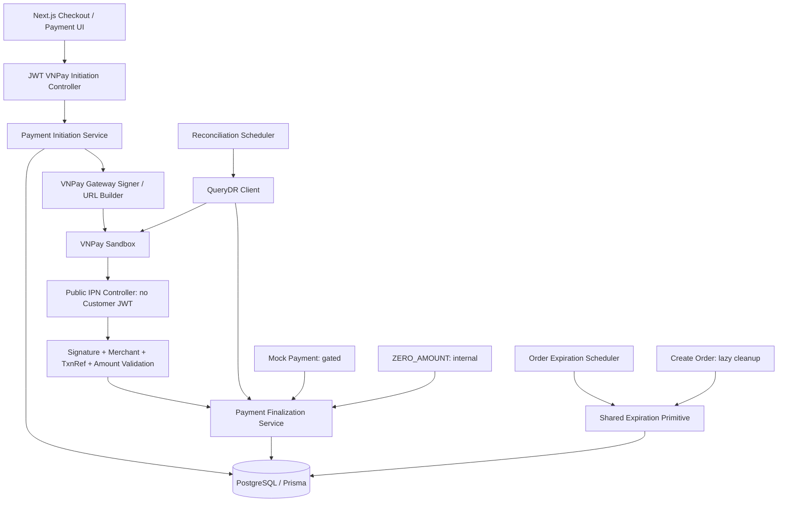
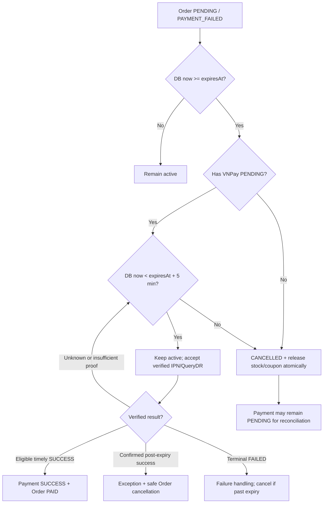

# BrewLite — Payment Architecture Design (VNPay Phase 2)

| Thuộc tính | Giá trị |
|---|---|
| Document | Payment Architecture Design |
| Version | **v1.0 — Final Review Candidate** |
| Date | 30/10/2026 |
| Owner | HKhang — Technical Lead / VNPay Backend Owner |
| Status | **READY FOR ARCHITECTURE BASELINE APPROVAL / NOT YET APPROVED** — các verification gates vẫn mở |
| Target | Sprint Phase 2: 31/10/2026–03/11/2026 |
| Source of truth | `docs/decisions/VNPay_Phase2_Change_Request.md` — BR-01…BR-06 Approved |

> **Phân loại quyết định:** `BASELINE` = yêu cầu nghiệp vụ đã chốt; `PROPOSED` = giải pháp kỹ thuật của tài liệu này, cần Leader duyệt; `VERIFY` = cần xác thực ở code/migration/VNPay Sandbox trước khi merge. Chưa coi các tên endpoint, field và class đề xuất trong tài liệu này là API Contract v4.0 Approved.

## 1. Mục tiêu, phạm vi và nguồn tham chiếu

### 1.1. Mục tiêu

Mở rộng Payment Foundation Phase 1 của BrewLite (NestJS, Prisma 7, PostgreSQL; Next.js frontend) để hỗ trợ VNPay **Sandbox** bất đồng bộ, đồng thời bảo lưu Mock có kiểm soát và thanh toán nội bộ `ZERO_AMOUNT`. Tránh phá vỡ Catalog/Auth/Cart/Order History và các dữ liệu Phase 1.

**Trong phạm vi:** Payment initiation, VNPay URL/signature, IPN, QueryDR, idempotent finalization, retry có kiểm soát, Order TTL 15 phút + Grace 5 phút, reconciliation, ZERO_AMOUNT, Mock environment policy, tích hợp Frontend và kiểm thử.

**Ngoài phạm vi:** thanh toán production/tiền thật, refund tự động, giao diện quản trị đối soát đầy đủ, deploy production, các gateway khác.

### 1.2. Baseline và tài liệu nguồn

1. **Approved:** `VNPay_Phase2_Change_Request.md` (BR-01…BR-06), bản approved v1.0.
2. **Phase 1 baseline:** `BrewLite_API_Contract_v3.0.md`; mã thực tế của `backend/src/payments`, `backend/src/orders`, `backend/prisma/schema.prisma`.
3. **Requirements:** v3.1 Phase 2, chốt theo thông tin Leader; **US/AC v2.3 và Use Case v3.1** phải rà trạng thái Approved lại trước khi phê duyệt kiến trúc cuối. ERD/Prisma Delta do CKhang soạn chưa xác minh đã Approved.
4. **External:** VNPay Sandbox integration specification. Các quy định thực tế về tham số, chữ ký, hạn URL, mã trạng thái và IPN/QueryDR phải kiểm tra với tài liệu và Sandbox hiện hành trước khi triển khai.

**Quy tắc ưu tiên khi có mâu thuẫn:** Approved Change Request > các thiết kế đề xuất Phase 2; giữ nguyên Phase 1 tại vùng không bị Change Request thay thế. Mâu thuẫn phải được ghi vào decision log; không âm thầm sửa BR.

## 2. Kết quả audit và quyết định Keep / Modify / Add

| Thành phần hiện hữu | Hiện trạng được quan sát | Hướng |
|---|---|---|
| `payments.service.ts` | Mock đồng bộ: kiểm tra ownership → replay/idempotency → advisory lock → `FOR UPDATE` Order → success/failure trong cùng transaction | **MODIFY:** bảo lưu Mock semantics, tách finalization chung; không trộn gateway HTTP vào DB transaction |
| `payment-processor.ts` | Abstract `execute(userId,key,dto)` chỉ phản ánh Mock sync | **MODIFY:** giới hạn nó cho Mock legacy hoặc thay bằng interface theo use case, tránh một interface ép mọi provider synchronous |
| `mock-payment.service.ts` | `evaluate()` trả SUCCESS/FAILED theo test credentials | **KEEP** thuật toán test; **ADD** policy chặn ở production |
| `payment-snapshot.ts` | Validator yêu cầu `mockReference`, `methodLast4`, kết quả terminal | **KEEP** cho snapshot Mock cũ; **ADD** serializer/validator riêng cho VNPay và ZERO_AMOUNT |
| `payments.controller.ts` | `POST /payments` có JWT Guard cấp class | **KEEP** Mock route với policy; **ADD** controller IPN không yêu cầu JWT nhưng bắt buộc xác minh chữ ký |
| `orders.service.ts` | `create()` gọi `expireOrderInTransaction()` trên active Order; `getMine()` chỉ lấy SUCCESS/FAILED, đọc Mock snapshot | **MODIFY** cả lazy expiration và history projection |
| `order-expiration.service.ts` | Sweep mỗi 60s, chọn Order quá `expires_at`, gọi shared primitive | **MODIFY** theo Grace; kiểm tra lại sau khóa trong primitive |
| `order-expiration.config.ts` | Config enable/batch size; interval 60s | **KEEP**, có thể thêm tùy chọn cấu hình grace/reconciliation test |
| `order-state.service.ts` | `PAID → PREPARING → READY → COMPLETED` với Order row lock | **KEEP**, không thêm trạng thái Order `GRACE` |
| `inventory-policy.ts` | Reserve stock atomically; `expireOrderInTransaction` khóa Order, cập nhật CANCELLED, hoàn inventory/coupon một transaction | **MODIFY** điều kiện được phép hủy; **KEEP** one-time release semantics |
| `inventory-transaction.ts` | Transaction ReadCommitted, lock timeout, retry deadlock/serialization/lock timeout | **KEEP** wrapper; không retry các kết quả payment không chắc chắn như lỗi transient đã commit |
| `schema.prisma` | Payment chỉ SUCCESS/FAILED, CARD/WALLET; unique `(userId,idempotencyKey)`; `responseSnapshot` Json bắt buộc | **MODIFY** schema có kiểm soát; xác minh partial indexes từ SQL migrations |
| `scrum51_payment_migration_test.sql` | Có test các invariants DB Phase 1 | **EXTEND** test migration, pending VNPay, provider và dữ liệu legacy |

## 3. Invariants bắt buộc (BASELINE)

1. Một Order có **tối đa một Payment SUCCESS** qua mọi provider; không double coupon consume, loyalty award, stock reserve/release.
2. Một Order có **tối đa một VNPay Payment PENDING** cùng lúc. Retry chỉ khi attempt trước **FAILED cuối cùng**, Order còn hạn và chưa PAID/CANCELLED. **Cross-provider safety:** khi có VNPay PENDING/chưa xác định kết quả, cấm khởi tạo Mock và ZERO_AMOUNT trên cùng Order, kể cả trong môi trường demo; không được dùng gateway/provider khác để vượt qua một attempt chưa đối soát.
3. Không tin `amount`, `userId`, `status` hay kết quả do frontend tự gửi. Amount lấy từ Order snapshot; VNPay amount là VND × 100 khi mapping tham số gateway.
4. `Payment.status ∈ {PENDING,SUCCESS,FAILED}`; `FAILED/SUCCESS` terminal; mất IPN, hết URL hoặc request timeout không phải bằng chứng FAILED; `EXPIRED` chỉ là failureReason khi gateway xác nhận cuối cùng.
5. `order.expiresAt = createdAt + 15 phút`; không tạo attempt mới sau hạn. `vnp_ExpireDate <= order.expiresAt` theo định dạng gateway. Grace 5 phút để **xác minh**, không cấp quyền thanh toán mới.
6. Trong Grace, Order còn active và giữ inventory/coupon khi VNPay PENDING. Hết Grace vẫn chưa có kết quả: CANCELLED + release nguyên tử; Payment tiếp tục PENDING để reconciliation.
7. SUCCESS đến sau Order CANCELLED: ghi nhận **kết quả giao dịch đã xác minh** và đánh dấu exception; không tự phục hồi Order, không fulfill, không consume coupon/cộng loyalty lần nữa, không auto-refund. **SUCCESS tài chính sau `expiresAt` khi Order chưa CANCELLED** cũng không được tự chuyển Order thành PAID: lưu bằng chứng, đánh dấu exception và đưa Order vào luồng hủy/release an toàn theo thời gian DB; nếu bằng chứng thời gian thanh toán thiếu hoặc không đủ tin cậy thì đối soát và không tự fulfill.
8. IPN và QueryDR đi qua **cùng finalization**; chữ ký/giao dịch/merchant/amount phải được kiểm tra trước thay đổi trạng thái.
9. ZERO_AMOUNT: Payment SUCCESS `amountVnd = 0` nội bộ, không gọi VNPay/Mock, không cộng điểm; dùng cùng finalization rules.
10. Mock chỉ test/demo khi backend cho phép; **disabled production**, không fallback tự động từ VNPay PENDING/uncertain.

## 4. Sơ đồ kiến trúc và ranh giới module (PROPOSED)



### 4.1. Thành phần và owner

| Component logic | Owner | Trách nhiệm | Không chịu trách nhiệm |
|---|---|---|---|
| VNPay Gateway / Initiation | HKhang | Tạo URL/transaction reference, ký request, kiểm tra ownership, pending attempt và replay | Không tự cập nhật coupon/loyalty |
| IPN Controller / QueryDR Client | HKhang | Parse, xác minh chữ ký, mapping result, gọi finalization | Không để IPN tin Return URL hoặc bypass DB rules |
| Shared Payment Finalization | Hoàng | Transaction atomic cho trạng thái Payment/Order, coupon, loyalty, late outcome | Không gọi HTTP gateway trong transaction |
| DB schema/migrations | Thụy | Provider/status metadata/indexes/migration/test dữ liệu cũ | Không tự đổi BR |
| Reconciliation Scheduler | Thụy | Lập lịch QueryDR, lease/claim chống chạy trùng, audit/manual review | Không tự set FAILED khi timeout |
| Order Expiration / ZERO_AMOUNT / Mock policy | CKhang | Shared expiration policy, grace; internal zero flow và Mock config | Không viết một finalization song song |
| Checkout/Payment UX | Khánh | Redirect, pending/result/retry theo backend | Không coi browser return là payment proof |
| Order History/Confirmation/E2E | Lập | Projection payment history, acceptance/integration tests | Không sửa Contract một cách độc lập |

**Triển khai NestJS:** ưu tiên bổ sung providers/controllers trong `PaymentsModule` và tích hợp với `OrdersModule`; không cần tách thành microservice hoặc tạo 8 modules mới. Tránh circular dependency bằng việc cô lập domain transaction helpers và xác lập imports rõ ràng.

## 5. Domain Model và schema delta (PROPOSED — chờ ERD Delta duyệt)

### 5.1. Trạng thái

- **Order** giữ bảy trạng thái hiện tại: `PENDING`, `PAYMENT_FAILED`, `PAID`, `PREPARING`, `READY`, `COMPLETED`, `CANCELLED`.
- **Payment attempt** có `PENDING`, `SUCCESS`, `FAILED` (enum bổ sung PENDING).
- **Provider**: `VNPAY`, `MOCK`, `ZERO_AMOUNT` (enum/cột mới **đề xuất**). Không đồng nhất provider với phương thức thẻ/ví `CARD/WALLET` Phase 1.
- **Reconciliation**: dùng metadata/enum riêng (ví dụ `NONE`, `SCHEDULED`, `REQUIRES_REVIEW`, `RESOLVED`), **không** làm phát sinh Payment status thứ tư.
- **Late SUCCESS**: hoàn toàn có thể `Payment.SUCCESS + Order.CANCELLED + review flag`. Không được thêm giả định SUCCESS luôn kéo Order thành PAID.

### 5.2. Trường cần thiết

| Nhóm | Dữ liệu mục tiêu | Ghi chú |
|---|---|---|
| Cơ sở | `id`, `orderId`, `userId`, `amountVnd`, `status`, `createdAt` | Có sẵn phần lớn |
| Provider | `provider` | Backfill records cũ về `MOCK` |
| Idempotency | `(userId,idempotencyKey)`, `requestHash` | Giữ unique, cùng key không tự sinh attempt khác |
| VNPay correlation | `vnpTxnRef` unique, transaction reference/ID gateway, original request metadata cần thiết | Không lưu secret; txnRef không tái sử dụng |
| VNPay proof | signed/verified outcome identifiers, `vnpPayDate` có độ tin cậy phù hợp, verifiedAt, response/transaction codes | Chỉ lưu dữ liệu cần cho kiểm toán |
| Reconciliation | nextCheckAt, attemptsCount, lastCheckedAt, reviewReason/status | Có thể là cột hoặc bảng phụ; tránh lưu raw nhạy cảm |
| Gateway evidence/exception | externalEventIdentity, txnRef, verifiedOutcome, evidenceTime, discrepancyReason | **Cần cơ chế ghi nhận riêng khi Order đã có SUCCESS khác**; immutable/idempotent, không vi phạm unique SUCCESS |
| URL replay | thông tin đầu vào chuẩn hóa đủ để tạo lại **cùng một URL/ký đúng cùng tham số**, hoặc snapshot URL có hạn | Không phụ thuộc clock hiện tại khi replay |
| Snapshot | INIT response và FINAL result được phân biệt; Mock legacy snapshot vẫn đọc được | Nếu `responseSnapshot` NOT NULL, thiết kế JSON PENDING hợp lệ hoặc migration tương thích |
| Method | current `PaymentMethod CARD/WALLET` | Đề xuất nullable/extended theo provider; quyết định cùng ERD Delta, không ép VNPay fake CARD |

**DB constraints phải xác minh qua SQL migrations thực tế:** unique one SUCCESS per Order across providers; unique one PENDING VNPay per Order; unique txnRef; nonnegative amount; ownership/order amount consistency và active Order uniqueness. Prisma schema **không** thể hiện đầy đủ partial indexes PostgreSQL, nên không kết luận thiếu index chỉ từ Prisma.

## 6. Payment Initiation và replay (PROPOSED)

```mermaid
sequenceDiagram
  participant FE as Frontend
  participant API as Initiation API
  participant DB as PostgreSQL
  participant GW as VNPay Signer
  participant VNP as VNPay Sandbox
  FE->>API: JWT + Idempotency-Key + orderId
  API->>DB: Check ownership, replay; lock Order
  DB-->>API: Order valid and no pending VNPay attempt
  API->>GW: Build immutable request parameters
  GW-->>API: Signed payment URL
  API->>DB: Insert PENDING attempt + replay data; commit
  API-->>FE: paymentId + PENDING + paymentUrl + expiresAt
  FE->>VNP: Redirect browser
```

**Quy tắc:** ownership check trước khi tiết lộ replay; replay cùng `(userId,key,requestHash)` không tạo attempt; key khác khi đã có VNPay PENDING -> từ chối `PAYMENT_IN_PROGRESS`; key trùng nhưng payload khác -> idempotency conflict. Mọi kiểm tra được lặp lại sau `FOR UPDATE` Order. URL phải được ký ở backend và `vnp_ExpireDate` không vượt Order expiry. Order 0 VND không khởi tạo VNPay.

**Điểm thiết kế cần quyết định trong Contract v4.0:** endpoint cụ thể (đề xuất `POST /payments/vnpay/initiate`), status code 201 lần đầu / 200 replay, JSON response và cách replay immutable URL sau expiry. Chỉ coi đây là draft, chưa phải Contract Approved. Nếu response HTTP thất lạc sau commit, retry phải phục hồi attempt cũ an toàn. Giao diện không redirect URL đã hết hạn.

**Cạnh tranh:** nếu phải ký URL trước commit, signer là thao tác cục bộ (không gửi request HTTP thanh toán); persist đầy đủ tham số bất biến để không mất transaction reference khi retry. Không gọi QueryDR/API ngoài trong lock Order.

## 7. IPN và Finalization (PROPOSED)

```mermaid
sequenceDiagram
  participant VN as VNPay
  participant IPN as IPN Controller
  participant VER as Validator
  participant FIN as Finalization
  participant DB as PostgreSQL
  VN->>IPN: Signed callback
  IPN->>VER: Verify HMAC, TMNCode, TxnRef, amount, result
  alt Invalid proof
    VER-->>IPN: Reject/no mutation
  else Verified outcome
    VER->>FIN: Normalized verified outcome
    FIN->>DB: Transaction + Order FOR UPDATE
    FIN->>DB: Re-read Payment + Order + expiration
    alt Eligible success
      FIN->>DB: Payment SUCCESS; Order PAID; coupon CONSUMED; loyalty once
    else Terminal failure
      FIN->>DB: Payment FAILED; Order PAYMENT_FAILED or CANCELLED per expiry
    else Late success on CANCELLED
      FIN->>DB: Payment SUCCESS + REVIEW FLAG; Order remains CANCELLED
    else Duplicate/contradictory
      FIN->>DB: No duplicate side effects; record discrepancy
    end
    DB-->>FIN: Commit
    FIN-->>IPN: Result
  end
  IPN-->>VN: VNPay RspCode / Message
```

**Signature and identity gate:** HMAC-SHA512; verify configured TMNCode, unique known TxnRef, amount = persisted Order amount ×100, response vs transaction status (both `'00'` for SUCCESS per BR-04), trustworthy verified pay time. Return URL is **never** authoritative payment proof. Invalid inputs do not mutate state. Endpoint public with respect to Customer JWT, **not** public trust.

**Atomicity:** IPN and QueryDR both normalize to same domain result and call the same finalization. Respond success only **after commit**. Return VNPay's documented `RspCode` and `Message`; duplicate/already-processed response must follow official behavior, not invented code.

**Lock order (technical proposal):** order row first, then payment attempt row as needed; both paths must use same order. Recheck statuses, owner and expiry under lock. Avoid transaction lock inversion with product/coupon/user resources. No HTTP calls inside transaction. Terminal conflict does not overwrite prior SUCCESS/FAILED, but records review/audit event.

**Critical special case:** Một **giao dịch tài chính đã được xác minh là SUCCESS** và **đủ bằng chứng thời điểm thanh toán `vnp_PayDate <= order.expiresAt`** khi Order còn active trong Grace có thể chuyển Order thành `PAID` (sau khi xác minh chữ ký, merchant, amount, trạng thái và bằng chứng thời gian). Nếu giao dịch tài chính SUCCESS nhưng thời điểm thanh toán **sau `expiresAt`**: Payment có thể ghi `SUCCESS` kèm exception **chỉ khi chưa tồn tại Payment SUCCESS khác của Order**; Order không được PAID, không consume coupon/cộng Loyalty và phải CANCELLED/release an toàn qua shared expiration policy. Nếu `vnp_PayDate` thiếu/không đủ tin cậy, **không được tự cho Order PAID**; lưu outcome tài chính đã xác minh và trạng thái `REQUIRES_REVIEW`, tiếp tục đối soát chứng cứ thời gian. Payment chỉ được đánh dấu `SUCCESS` khi chứng cứ trạng thái tài chính đủ tin cậy, độc lập với điều kiện fulfill Order. Trường hợp outcome tài chính cũng chưa đủ xác minh thì giữ `PENDING`, không tự coi là SUCCESS/FAILED. Đến cuối Grace, Order chưa chứng minh đủ điều kiện PAID phải CANCELLED và release theo BR-03; không tự refund.

**Giới hạn unique SUCCESS đa provider:** nếu Order **đã có Payment SUCCESS khác**, một callback VNPay được xác minh là thành công **không được insert/update thêm Payment SUCCESS** vì sẽ phá invariant `one SUCCESS per Order`. Giữ trạng thái attempt hiện có (hoặc đánh dấu trạng thái `REQUIRES_REVIEW`) và lưu **bằng chứng thành công tài chính riêng** trong immutable gateway event / exception record có định danh giao dịch, loại sự kiện, mã tham chiếu và thời gian; phát tín hiệu xử lý thủ công. Không ghi đè Payment terminal trước đó, không tác động Order/Coupon/Loyalty và không làm mất bằng chứng. Mô hình event/exception này là yêu cầu thiết kế dữ liệu cần CKhang/Thụy đối chiếu với ERD Delta; không thể chỉ dựa vào `Payment.status` để lưu mọi kết quả bên ngoài.

**Ranh giới finalization:** mỗi transaction khóa Order trước, sau đó đọc/khóa attempt và kiểm tra bất biến toàn Order, trạng thái đối soát, thời điểm chứng cứ rồi mới mutate. Quy tắc xử lý concurrent outcomes, late successes và duplicate phải idempotent trên **cùng gateway event identity**; không tạo trùng exception records. API Contract v4.0 chốt error/response và mapping chi tiết, không được đảo ngược các invariants trên.

## 8. Order expiration, active Order và Grace (BASELINE + PROPOSED implementation)



- **Sửa một điểm dùng chung duy nhất:** `expireOrderInTransaction(tx, orderId)` trong `inventory-policy.ts`. Đây là primitive được cả Scheduler và `OrdersService.create()` gọi. Nếu chỉ chỉnh Scheduler thì Create Order có thể hủy Order trong Grace.
- Kiểm tra `VNPay PENDING` và `DB clock` **sau `SELECT ... FOR UPDATE`**; việc quét candidates trước lock chỉ dùng để tìm, không làm bằng chứng cho phép hủy.
- Trong Grace, trả `PENDING_ORDER_EXISTS` khi User cố tạo Order mới; không tạo hoặc giữ coupon/stock lần hai. Sau Grace Order thực sự CANCELLED mới cho tạo Order mới.
- `expireOrderInTransaction` giữ quy trình `CANCELLED` + hoàn stock + release coupon trong một transaction; với kết quả IPN/QueryDR cạnh tranh, một nhánh thắng, nhánh còn lại recheck sau lock.
- Không thêm trạng thái `GRACE` vào Order. Grace được tính từ `expiresAt` và tồn tại pending attempt.
- **SUCCESS tài chính không hợp lệ để fulfill** (thanh toán sau hạn, thiếu chứng cứ thời điểm): không được trở thành trạng thái Order PAID. Nếu chưa hết Grace, giữ quy tắc an toàn chờ đối soát; đến cuối Grace phải hủy/release, kể cả khi attempt đã được ghi nhận tài chính SUCCESS nhưng `Order` vẫn chưa đủ điều kiện PAID. Candidate selection không được bỏ sót các Order này chỉ vì không còn attempt `PENDING`.
- Scheduler giữ tick 60s Phase 1; **VERIFY** các candidate còn Grace không gây vòng lặp tốn tài nguyên hoặc trì hoãn xử lý các Order khác. Có thể lọc eligibility ở query đầu, nhưng primitive vẫn là source of truth.

## 9. QueryDR & reconciliation (BASELINE + PROPOSED)

- QueryDR Client ký và xác minh request/response theo VNPay specs; **`vnp_ResponseCode=00` chỉ nói API truy vấn thành công**, không khẳng định giao dịch SUCCESS; xét transaction status riêng.
- Lúc Order chạm **`expiresAt` (phút thứ 15)** mà VNPay còn PENDING, đánh dấu cần QueryDR và thực hiện ít nhất một lượt kiểm tra theo cơ chế claim/rate-limit trong Grace 5 phút; nhận IPN hợp lệ trong thời gian này vẫn qua finalization chung. Nếu tới **`expiresAt + 5 phút` (phút thứ 20)** chưa có kết quả đủ tin cậy: Order CANCELLED/release, Payment PENDING. Trong **60 phút tính từ thời điểm kết thúc Grace** tiếp tục QueryDR tối đa mỗi chu kỳ 10 phút theo lịch được cấu hình và giới hạn VNPay; sau horizon, ngừng job tự động, đánh dấu `REQUIRES_REVIEW`, Payment vẫn PENDING. Không diễn giải không có response là FAILED.
- Scheduler chỉ claim các attempt đủ lịch và chưa được xử lý; tránh cùng một transaction bị nhiều worker query cùng lúc; dùng claim/lease có timeout hoặc DB advisory lock cho khâu claim. Lease phải hết hạn/khôi phục được nếu worker crash hay request timeout; `vnp_ResponseCode=94` (duplicate QueryDR request) không phải Payment FAILED.
- Tách ba bước: (1) claim công việc bằng transaction ngắn; (2) gọi VNPay **ngoài transaction**; (3) verify response rồi finalization transaction; (4) update reconciliation metadata. Rate-limit và timeout có giới hạn; không chạy lại vô hạn.
- **Outcome classification policy:** status `00` chỉ là SUCCESS nếu đầy đủ xác minh liên quan (và quy tắc response code phù hợp); `01`/đang xử lý không phải final FAILED; `02` chỉ thành FAILED nếu gateway xác nhận đây là kết quả cuối; `04` đảo giao dịch, `07` nghi ngờ gian lận và kết quả bất thường cần exception/review, **không** mở quyền retry như FAILED thường. Các mã ngoài danh mục được fail-closed, đối soát hoặc review. Một thông báo trái ngược với terminal status đã lưu không tự overwrite; ghi discrepancy. Mapping chính xác cho từng loại thông điệp IPN/QueryDR chốt tại Contract v4.0 theo tài liệu VNPay PAY (không lấy bảng mã của sản phẩm VNPay khác).
- **VERIFY:** các hạn mức, tần suất QueryDR theo tài liệu merchant VNPay và Sandbox, liệu mốc 10 phút có phù hợp hạn mức thật. QueryDR `vnp_ResponseCode=91` (không tìm thấy giao dịch) và `94` (trùng yêu cầu trong cửa sổ giới hạn) **không tự là Payment FAILED**. Mỗi lần QueryDR dùng `vnp_RequestId` riêng phù hợp quy định và ký/kiểm tra checksum theo **canonicalization riêng của QueryDR**, không áp dụng máy móc công thức checksum IPN. <Nguồn kiểm chứng: VNPay PAY QueryDR docs>.

## 10. ZERO_AMOUNT và Mock (BASELINE)

### 10.1. ZERO_AMOUNT

- Order tồn tại, thuộc User JWT, totalVnd **đúng 0** và còn hạn, chưa PAID/CANCELLED.
- Tạo Payment SUCCESS (provider `ZERO_AMOUNT`, amount=0) qua finalization chung, coupon HELD → CONSUMED, pointsEarned=0, inventory không reserve lại; không gọi VNPay/Mock.
- Idempotency/ownership/lock và unique SUCCESS được áp dụng đầy đủ; không tự hoàn tất khi Order đã quá hạn.

### 10.2. Mock

- Giữ `POST /payments` legacy cho test/demo ở môi trường được backend bật theo policy. Disabled production; không fallback từ VNPay pending/uncertain.
- `MockPaymentService.evaluate()` giữ test rules Phase 1; finalization được chia sẻ để thống nhất tài nguyên, nhưng API legacy và response snapshot phải duy trì tương thích.
- **Cross-provider gate bắt buộc:** không cho phép Mock hoặc ZERO_AMOUNT nếu Order có VNPay PENDING/uncertain; các provider phải dùng cùng Order lock/guard và kiểm tra lại sau lock. Điều kiện chuyển provider phải thỏa BR-05, giới hạn SUCCESS chung và không tự fallback; Mock không được che lỗi VNPay.

## 11. Security, configuration và observability

- Chỉ backend giữ `vnp_TmnCode`, `vnp_HashSecret` (secret), QueryDR credentials; không đưa vào source, Dockerfile, Git, frontend, logs hoặc screenshots. **HashSecret từng xuất hiện trong ảnh: phải rotate trước tích hợp.**
- HMAC-SHA512 canonicalization cần đối chiếu chính xác tài liệu VNPay (thứ tự, encoding và tập tham số được ký); test cả ký URL và verify IPN/QueryDR, tampering và replay.
- Public IPN không dùng JWT nhưng phải xác minh chữ ký và đủ dữ liệu đối chiếu; không chỉ whitelisting IP.
- Customer-facing APIs dùng JWT + ownership-before-state check; Order khác owner và Order không tồn tại cùng 404.
- Config qua `.env.example` chỉ ghi **tên biến và placeholder**, không secret thật. `MOCK_PAYMENT_ENABLED` (tên đề xuất) phải fail-closed trong production. `VNPAY_IPN_URL`, `VNPAY_RETURN_URL` công khai cần cấu hình chính xác khi dùng ngrok.
- Logs chỉ ghi paymentId/txnRef dạng an toàn, code trạng thái, correlationId, outcome class và timestamp; không log full callback, card details, HashSecret, full signed URL chứa dữ liệu nhạy cảm.
- Ngrok HTTPS chuyển đến port backend đang expose trên host; khi chạy Docker phải đảm bảo IPN có thể đến API và callback không phụ thuộc browser.

## 12. API surface dự kiến (chưa phải Contract v4.0)

| Surface | Authentication | Mục đích | Ghi chú |
|---|---|---|---|
| `POST /payments` (existing) | JWT | Mock legacy | Giữ tương thích, policy giới hạn môi trường |
| `POST /payments/vnpay/initiate` (**proposed**) | JWT | Tạo VNPay PENDING / URL | Body đề xuất `{orderId}`; key header bắt buộc; chưa chốt HTTP schema |
| `GET /payments/vnpay/ipn` (baseline) | HMAC VNPay | Nhận outcome authoritative | Không có Customer JWT; response VNPay schema riêng |
| Return URL handler / FE route (**proposed**) | Browser redirect | Hiển thị chờ/tra cứu kết quả | Không tự finalization chỉ bằng query frontend |
| Payment status read (**proposed**) | JWT + ownership | FE poll trạng thái an toàn | Chưa chốt endpoint/path và response |
| ZERO_AMOUNT initiation (**proposed**) | JWT | Hoàn tất Order 0đ | Chưa chốt tách route hay polymorphic API |
| QueryDR client | Backend internal only | Reconciliation | Không công khai credential/endpoint cho Customer |
| `GET /orders/me` (existing) | JWT | History/projection | Phải hiểu VNPay PENDING và non-Mock snapshots |

**Không tạo hai endpoint public cho cùng một hành vi trước khi duyệt Contract.** HTTP status/error code (ví dụ `ORDER_EXPIRED`, `ZERO_AMOUNT_REQUIRED`) trong các trao đổi trước **chỉ là đề xuất**.

## 13. Kế hoạch triển khai và kiểm thử

### 13.1. Mapping Jira dự kiến

| Jira plan ID | Owner | Hạng mục |
|---|---|---|
| P2-01 | HKhang | Architecture + API Contract v4.0 |
| P2-02 / P2-06 | Thụy | Schema/migration và DB tests |
| P2-03 / P2-07 | HKhang | VNPay Gateway, initiation, IPN, QueryDR |
| P2-04 / P2-05 | Hoàng | Shared Finalization và concurrency tests |
| P2-08 | Thụy | Reconciliation Scheduler |
| P2-09 / P2-10 / P2-11 | CKhang | Grace, ZERO_AMOUNT, Mock policy |
| P2-12 / P2-13 | Khánh | VNPay UI và frontend tests |
| P2-14 / P2-19 | Lập | Order History + E2E/regression |
| P2-15 / P2-16 | Hoàng / Khánh | Dockerfile Backend / Frontend |
| P2-17 | HKhang | Compose / packaging từ số 0 |
| P2-18 | Lập | Docker clean-run tests |
| P2-20 | Hoàng | README + báo cáo |

### 13.2. Bộ test chặn nghiệm thu

1. Legitimate initiate + replay same key; same key different payload; simultaneous same/different key; another user's Order.
2. Signed IPN SUCCESS/FAILED, invalid HMAC/TMNCode/txnRef/amount; duplicate IPN; IPN vs QueryDR race.
3. Order expiry đúng 15m; pending VNPay giữ Grace 5m; Create Order lazy expiration tôn trọng Grace; chưa rõ sau Grace CANCELLED + payment PENDING.
4. Late SUCCESS after CANCELLED: persist financial outcome + flag, không re-open Order/fulfill/coupon/loyalty.
5. Terminal conflicting notifications: không overwrite, flag review.
6. Retry chỉ khi prior attempt FAILED cuối và Order còn hạn; never retry PENDING on timeout.
7. ZERO_AMOUNT amount 0, coupon consumed, zero points, no gateway; no duplicate SUCCESS.
8. Mock legacy test/demo vẫn hoạt động khi enabled, bị từ chối trong production; không fallback tự động.
9. DB migration trên empty DB và DB Phase 1, legacy Mock snapshots đọc được; partial unique indexes enforce.
10. Frontend Return URL giả SUCCESS không tự báo PAID; history thể hiện PENDING; Docker Compose FE-BE-DB và Sandbox IPN từ ngrok.

## 14. Risks, open decisions và điều kiện Approved

| ID | Hạng mục | Loại | Owner | Điều kiện giải quyết |
|---|---|---|---|---|
| AR-01 | VNPay `vnp_ExpireDate` ngắn hơn 15m và tình huống initiation sát hạn | VERIFY | HKhang | Test Sandbox / docs, giữ TTL BR-03 |
| AR-02 | Chính xác mapping HMAC/QueryDR/transaction statuses và IPN `RspCode` | VERIFY | HKhang | Test vectors và official docs |
| AR-03 | Database partial unique indexes & migration đã có | VERIFY | Thụy | Kiểm tra SQL migrations và PostgreSQL catalog |
| AR-04 | Payment provider, `method` nullable/enum, init/final snapshots, late-success evidence columns | PROPOSED | Thụy + HKhang | ERD Delta/Prisma được Leader duyệt |
| AR-05 | Endpoint, DTO, HTTP statuses, errors cho Initiation, status polling, ZERO_AMOUNT | PROPOSED | HKhang | API Contract v4.0 được Leader duyệt |
| AR-06 | Quy tắc payDate thiếu/không đáng tin, post-expiry gateway success | PROPOSED / VERIFY | HKhang + Hoàng | Chốt evidence policy không vi phạm BR-03 |
| AR-07 | Grace với multiple instances và lock ordering across Create Order/IPN/Scheduler | PROPOSED | CKhang + Hoàng | Concurrency integration tests |
| AR-08 | QueryDR scheduling, limits, exactly 60m horizon | VERIFY | Thụy | Sandbox limit và kịch bản đo kiểm |
| AR-09 | Trạng thái Approved của US/AC v2.3, UC v3.1, ERD delta | DEPENDENCY | Leader | Consistency review cuối |
| AR-10 | HashSecret bị lộ trong ảnh trước đây | SECURITY ACTION | HKhang | Rotate test secret, xác nhận không còn trong Git/log |
| AR-11 | Cross-provider Mock/ZERO_AMOUNT khi VNPay PENDING | DESIGN RULE | CKhang + Hoàng | Tạo guard dùng chung và integration tests chống thanh toán đè |
| AR-12 | SUCCESS sau Order expiry nhưng trước Grace end | DESIGN RULE | Hoàng + CKhang | Kiểm chứng xử lý tài chính, exception và Order cleanup bằng race tests |
| AR-13 | Gateway SUCCESS thứ hai khi Order đã có Payment SUCCESS (multi-provider, late callback) | DESIGN RULE / ERD GATE | Hoàng + Thụy | Ghi bằng chứng/exception ngoài unique Payment.SUCCESS, idempotent, không phá dữ liệu hay fulfillment |
| AR-14 | Giao dịch tài chính SUCCESS nhưng thiếu bằng chứng `vnp_PayDate` đáng tin; Payment không còn PENDING nhưng Order chưa PAID | DESIGN RULE | Hoàng + CKhang | Rõ metadata và scheduler hủy Order đúng hạn cuối Grace, không phụ thuộc duy nhất Payment PENDING |

### 14.1. Điều kiện duyệt Payment Architecture

- Leader chấp thuận các **PROPOSED** quan trọng, đặc biệt field model/interface/transaction ordering; không âm thầm coi những đề xuất là đã chốt.
- Không còn mâu thuẫn với BR-01…BR-06, Requirements v3.1, US/AC, Use Case và ERD Delta đã duyệt.
- Phương án late SUCCESS, missing payDate và terminal conflict được mô tả nhất quán; các ràng buộc DB có migration/test khả thi.
- Mọi external assumption thuộc `VERIFY` được kiểm tra hoặc được ghi rõ là deployment/integration gate, không khẳng định đã test Sandbox.
- Sau Architecture Approved mới khóa **API Contract v4.0**; tiếp đó merge PR tài liệu và cho các task phụ thuộc code theo phiên bản cụ thể.

---

**Final review revision:** Đã bổ sung chính sách cross-provider, late financial SUCCESS sau expiry nhưng chưa CANCELLED, phân loại gateway outcome và mốc reconciliation. Chưa chứng minh sự tương thích Sandbox thực tế, migrations hoặc review toàn bộ UC/ERD mới nhất; các mục VERIFY/DEPENDENCY tiếp tục là integration gates.

**Kết luận thiết kế:** mở rộng Payment Foundation thay vì rewrite; dùng **một Payment Finalization dùng chung** và **một expiration primitive dùng chung**; tách hai state machine Payment/Order và coi reconciliation là metadata riêng. Tài liệu này là **ứng viên duyệt architecture baseline**; không phải bằng chứng VNPay Sandbox/migration/E2E đã chạy.
