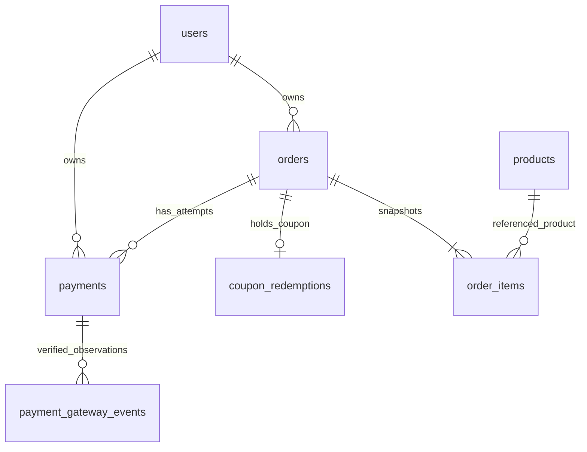

# BrewLite ERD và Prisma Delta Phase 2

**Phiên bản:** 0.2.2 — CK-R01–CK-R03 Review-Updated Candidate (31/10/2026)  
**Người phụ trách:** CKhang  
**Bàn giao:** HKhang và Thụy review, phục vụ P2-02 / SCRUM-76  
**Trạng thái:** **L1 APPROVED về hướng kiến trúc; L2 nguyên tắc đã thống nhất tại vòng review L1–L3; L3 Backend VERIFY**. Chưa có biên bản/Jira xác thực phê duyệt L2 chính thức của Leader; không đánh đồng quyết định trong trao đổi với phê duyệt toàn bộ thiết kế. Chi tiết field/enum/CHECK/index là **Proposed Design** chờ duyệt riêng; **chưa sửa schema chính thức, chưa migrate, chưa test DB thực**.  
**File đi kèm:** [schema_phase2_proposed_v0.2.2_CK-R01-R03_UPDATED.dbml](schema_phase2_proposed_v0.2.2_CK-R01-R03_UPDATED.dbml)

**Phạm vi đối chiếu và hiệu chỉnh v0.2.2:** `BrewLite_ERD_Prisma_Delta_Phase2_v0.2.md`, `schema_phase2_proposed.dbml` từ lượt review trước; `schema.prisma`, `migrations.zip`, `schema(1).dbml`, `BrewLite_Payment_Architecture_Phase2_v1.0.md` người dùng vừa gửi; Requirements v3.1 và Approved VNPay BR-01–06 có trong cuộc trò chuyện. **API Contract v4.0 Review 2 Revised Candidate được người yêu cầu đối chiếu và yêu cầu đồng bộ CK-R01–CK-R03, nhưng chưa cung cấp bản file để đọc trực tiếp; không có quyền truy cập PostgreSQL đang chạy.**

## 1. Phương án đề xuất

Chọn **mở rộng bảng `payments` hiện có và thêm đúng một bảng `payment_gateway_events`**. Mỗi hàng Payment vẫn là một attempt; không tạo thêm bảng VNPay Payment độc lập hoặc bảng reconciliation. Lịch QueryDR, claim/lease và chỉ báo cần review nằm trên Payment. Event lưu bằng chứng IPN/QueryDR độc lập với trạng thái terminal của Payment.

Các lựa chọn cụ thể:

- Bổ sung `PaymentStatus.PENDING`; giữ SUCCESS/FAILED terminal.
- Thêm provider bắt buộc MOCK/VNPAY/ZERO_AMOUNT. Giữ enum method CARD/WALLET, đổi cột method thành nullable: Mock bắt buộc có method; VNPay/ZERO_AMOUNT dùng NULL.
- Giữ nguyên JSON response Mock cũ. Đổi `response_snapshot` thành nullable có CHECK theo provider; VNPay dùng `initiation_snapshot` và `final_outcome_snapshot` riêng.
- Giữ unique idempotency theo User và unique SUCCESS trên toàn Order. Thêm unique TxnRef và partial unique VNPay PENDING trên Order.
- **CK-R01:** thêm duy nhất `payments.updated_at` (`timestamptz(6)`, NOT NULL) làm timestamp thay đổi của từng Payment; dùng `orders.updated_at` **đã có sẵn** làm nguồn thay đổi của Order, không thêm cột vào `orders`.
- Không thay cột, enum, quan hệ hoặc dữ liệu của Order, Coupon, Inventory, Catalog, Auth và Cart. Logic dùng chung chỉ mở rộng ở những điểm Requirements Phase 2 cho phép: grace, finalization, provider policy và projection Payment.
- Không thêm bảng refund, ledger, admin, queue hay InventoryMovement. Bảng inventory_movements chỉ xuất hiện như mục SHOULD trong **DBML chính thức được cung cấp nhưng chưa có trong Prisma/migrations**; bản cập nhật v0.2 không đưa nó vào phạm vi triển khai.

**Quyết định L1 (đã APPROVED về hướng):** giữ một bảng `payments` mở rộng và một bảng mới `payment_gateway_events`; không tạo bảng reconciliation riêng, metadata/claim/lease nằm trên Payment. L1 **không phê duyệt tự động tên field, enum, CHECK, indexes, Prisma model hoặc migration**. Các chi tiết vật lý dưới đây vẫn chờ review thiết kế để giao SCRUM-76. **L2 đã thống nhất nguyên tắc trong trao đổi L1–L3**, song cần lưu quyết định/biên bản chính thức nếu ghi “Leader Approved”; **L3 Backend VERIFY**, không biến các giá trị timeout/lease đề xuất thành chuẩn nghiệp vụ.

**Giới hạn nguồn:** đã có các yêu cầu CK-R01–CK-R03 do người dùng trích từ vòng đối chiếu API Contract v4.0 Candidate, nhưng chưa có toàn văn Candidate để kiểm tra exact DTO/enum/status code; chưa có snapshot PostgreSQL đang chạy hoặc source payment mới nhất ở cùng lượt upload. Có thể review thiết kế database ngay, nhưng không xác nhận tương thích DTO/HTTP/replay response cuối cùng trước khi bổ sung Contract.

## 2. Baseline và nguồn tham chiếu

| Nguồn                                                                                                                                                                                               | Phiên bản/trạng thái sử dụng                                                                                                                                                                                                     | Đã đối chiếu                                                                                                                                                                                                       |
| --------------------------------------------------------------------------------------------------------------------------------------------------------------------------------------------------- | -------------------------------------------------------------------------------------------------------------------------------------------------------------------------------------------------------------------------------- | ------------------------------------------------------------------------------------------------------------------------------------------------------------------------------------------------------------------ |
| [Requirements v3.1](../../../BrewLite_Requirements_Specification_v3.1.docx)                                                                                                                         | **Approved theo quyết định Leader được người yêu cầu xác nhận tại vòng CK-R03 (31/10/2026)**. Bản PDF/Word trước đó còn header “Chờ review”; owner cần cập nhật Document Control/đính kèm link quyết định để đồng nhất metadata. | Baseline Phase 2; §7.7.1 FR-PAY-007–012; §9.9 BR-01–06; §10.3; §16                                                                                                                                                 |
| [US–AC Phase 2 v2.3 trên GitHub](https://github.com/brewlite-project/brewlite/blob/552d75fffbe8a18995b50e72448eaa3a6dfa81a3/docs/docs_Phase2/BrewLite_User_Stories_Acceptance_Criteria_Phase2.docx) | Header 31/10/2026; REVIEW FIXED CANDIDATE, chờ consistency review cuối                                                                                                                                                           | US-VNP-01–06, đặc biệt AC 01-05, 02-15, 03-09, 04-05; các cập nhật review F01–F13                                                                                                                                  |
| API Contract v4.0 Review 2 Revised Candidate                                                                                                                                                        | **CANDIDATE, chưa Approved; người yêu cầu đã đối chiếu và giao CK-R01–CK-R03; chưa tải file Contract để đối chiếu từng kiểu enum/DTO**                                                                                           | Bổ sung persisted `lastUpdatedAt`, projection `resolution`/`requiresReview`/`canRetry`/`hasFinancialException`/PaymentSummary ở mức mapping dữ liệu; tên enum/HTTP shape phải khóa theo Contract khi được cung cấp |
| [API Contract v3.0](../../../api/BrewLite_API_Contract_v3.0.md)                                                                                                                                     | Baseline Phase 1, giữ nguyên lịch sử                                                                                                                                                                                             | §3 idempotency/Mock; §4 history; §6 expiration; §7 constraints                                                                                                                                                     |
| [VNPay Change Request](../../../decisions/VNPay_Phase2_Change_Request.md)                                                                                                                           | Approved BR-01–BR-06                                                                                                                                                                                                             | Nguồn nghiệp vụ cho các override Phase 2                                                                                                                                                                           |
| [Architecture Phase 2 v1.0](../BrewLite_Payment_Architecture_Phase2_v1.0.md)                                                                                                                        | NOT YET APPROVED trong file hiện có                                                                                                                                                                                              | §5–10: correlation, event/evidence, grace, QueryDR và ZERO_AMOUNT                                                                                                                                                  |
| [Prisma hiện tại](../../../../backend/prisma/schema.prisma), [DBML chính thức](../../../../database/schema.dbml), [migrations](../../../../backend/prisma/migrations)                               | **Đã đối chiếu trực tiếp các file người dùng tải lên ngày 31/10/2026** (`schema.prisma`, `schema(1).dbml`, `migrations.zip`); commit local cũ chỉ là tham chiếu lịch sử                                                          | Schema code hiện tại, SQL trong bảy migration và sai khác DBML; chưa kiểm tra DB đang chạy                                                                                                                         |
| Bản thiết kế v0.2 được gửi kèm để review                                                                                                                                                            | Đầu vào review của người yêu cầu                                                                                                                                                                                                 | D1–D5 được thay bằng đề xuất cụ thể tại §11                                                                                                                                                                        |

**CK-R03 metadata:** Requirements v3.1 được xem là **Approved theo quyết định Leader được người yêu cầu xác nhận**; không nhầm với việc toàn bộ Payment Architecture hoặc schema vật lý đã Approved. File Requirements cũ có thể còn header “Chờ review”; owner phải đồng bộ Document Control/decision link tại repository. API Contract v4.0 Review 2 Revised vẫn là **Candidate**, không mặc nhiên chốt exact enum, HTTP DTO hay response code. BR-01–BR-06 là Approved baseline độc lập.

US–AC trên commit `552d75f` đã được bản thiết kế trước dùng làm nguồn tham chiếu; tại vòng này ưu tiên **file thực đính kèm** (Prisma/SQL/DBML/Architecture). Không tuyên bố commit remote là HEAD hiện tại. BR-01–BR-06 Approved; phần Architecture/API vẫn cần review.

**Kiểm soát phiên bản thiết kế:** v0.3 REVIEWED là bản review trước thời điểm cập nhật L1–L3, **Superseded về diễn giải L1/L2/L3** bởi v0.2.2 CK-R01–CK-R03 Candidate này; không dùng song song làm hai baseline hiện hành. Việc giữ chuỗi phiên bản v0.2.x biểu thị tiếp nối bản v0.2 L1–L3 đã bàn giao, **không có nghĩa quay lại logic L2 OPEN cũ**. L1 chỉ được duyệt về hướng, L2 là nguyên tắc thống nhất theo chỉ đạo đã cung cấp, phê duyệt vật lý và thông số L3 vẫn cần gate riêng.

## 3. Bảo toàn Phase 1 và ranh giới thay đổi

Luồng hiện có: Controller xác thực JWT → Service kiểm tra ownership/key, khóa Order → Prisma transaction lưu Payment và tác động Order/Coupon/Loyalty → PostgreSQL bảo vệ bằng FK, unique và CHECK. Expiration trong `inventory-policy.ts` được cả Create Order và Scheduler gọi. Phase 2 cần tích hợp vào cùng điểm khóa/đọc lại dữ liệu để tránh Create Order hủy đơn trong grace.

| Đối tượng                                       | Đề xuất Phase 2                                                             | Điều phải giữ                                                                                           |
| ----------------------------------------------- | --------------------------------------------------------------------------- | ------------------------------------------------------------------------------------------------------- |
| payments                                        | Thêm field/enum, `updated_at` cho API-03, nới 2 cột có CHECK bù, thêm index | Không đổi PK/FK, key/hash/snapshot Mock, amount và kết quả cũ                                           |
| payment_gateway_events                          | **Bảng mới duy nhất**                                                       | FK Restrict; không làm Payment SUCCESS thứ hai                                                          |
| orders                                          | Không đổi schema                                                            | 7 trạng thái; expiresAt gốc; financial/item snapshots; active-order unique                              |
| users                                           | Không đổi schema                                                            | JWT ownership; loyalty chỉ cộng một lần khi Order được thanh toán hợp lệ                                |
| coupons, coupon_redemptions                     | Không đổi schema                                                            | HELD → CONSUMED hoặc RELEASED đúng một lần; không giữ quota lần hai khi retry                           |
| products, order_items và bảng Catalog liên quan | Không đổi schema                                                            | Reserve lúc tạo Order; không trừ stock khi SUCCESS; CANCELLED mới hoàn một lần                          |
| Mock API/snapshot                               | Giữ serializer và hash legacy                                               | Cùng key replay đúng dữ liệu cũ; không dùng serializer Mock đọc VNPay                                   |
| ZERO_AMOUNT/Mock policy                         | Áp dụng BR-06 cho giao dịch mới                                             | Không đổi bản ghi Mock 0đ lịch sử thành ZERO_AMOUNT; replay lịch sử còn theo baseline/policy được duyệt |

Không có thay đổi schema cho grace: `E = orders.expires_at`, `G = E + 5 phút`. Trong grace, Order vẫn PENDING/PAYMENT_FAILED để unique active Order tiếp tục bảo vệ. Không thêm Order.GRACE.

**L2 đã chốt:** chỉ cho `Order.PAID` nếu kết quả tài chính và **thời điểm thanh toán đáng tin cậy, hợp lệ so với `E`** được xác minh, đồng thời Order còn đủ điều kiện và chưa CANCELLED. Nếu gateway chứng minh SUCCESS nhưng thiếu timestamp đáng tin cậy, trong Grace **không tự suy thời gian** từ `receivedAt`, `verifiedAt` hoặc `finalizedAt`: tiếp tục xác minh. Từ `G` trở đi, xử lý CANCELLED/release theo BR-03; giữ chứng cứ tài chính và đánh dấu ngoại lệ, không refund tự động và không hồi sinh Order. Cách kiểm chứng timestamp VNPay vẫn `VERIFY` với Sandbox/Backend.

## 4. Thiết kế payments

### 4.1 Enum

| Enum PostgreSQL / Prisma                                  | Giá trị                                    | Phân loại                                                        |
| --------------------------------------------------------- | ------------------------------------------ | ---------------------------------------------------------------- |
| payment_status / PaymentStatus                            | SUCCESS, FAILED, **PENDING**               | Mở rộng enum hiện có; không EXPIRED                              |
| payment_method / PaymentMethod                            | CARD, WALLET                               | Giữ nguyên enum; chỉ đổi nullability cột                         |
| payment_provider / PaymentProvider                        | MOCK, VNPAY, ZERO_AMOUNT                   | Mới                                                              |
| payment_reconciliation_state / PaymentReconciliationState | NONE, SCHEDULED, RESOLVED, REQUIRES_REVIEW | Mới; trạng thái xử lý đối soát, không phải trạng thái thanh toán |

`requiresReview` khi cần projection được suy ra từ reconciliationState; không thêm một boolean thứ hai dễ lệch. `hasFinancialException` là cờ khác: đã có bất thường tài chính, không chỉ hết hạn đối soát. Không mở endpoint xử lý thủ công trong task này.

### 4.2 Từ điển toàn bộ cột

| Prisma / cột DB                                     | Kiểu PostgreSQL              | NULL  | Default                  | Vai trò                                                                                                                                                                                                                           |
| --------------------------------------------------- | ---------------------------- | ----- | ------------------------ | --------------------------------------------------------------------------------------------------------------------------------------------------------------------------------------------------------------------------------- |
| `id` / `id`                                         | `uuid`                       | Không | Không                    | Giữ UUID của attempt; application/Prisma sinh UUID.                                                                                                                                                                               |
| `orderId` / `order_id`                              | `uuid`                       | Không | Không                    | FK tới orders.id; không đổi ownership hoặc Order snapshot.                                                                                                                                                                        |
| `userId` / `user_id`                                | `uuid`                       | Không | Không                    | FK tới users.id; service kiểm tra bằng Order owner/JWT.                                                                                                                                                                           |
| `idempotencyKey` / `idempotency_key`                | `varchar(64)`                | Không | Không                    | Giữ scope User và unique chung mọi provider.                                                                                                                                                                                      |
| `requestHash` / `request_hash`                      | `varchar(128)`               | Không | Không                    | Giữ hash Mock cũ; hash mới theo operation/provider và payload canonical.                                                                                                                                                          |
| `amountVnd` / `amount_vnd`                          | bigint                       | Không | Không                    | Tiền VND nguyên từ Order; không lấy từ client.                                                                                                                                                                                    |
| `provider` / `provider`                             | payment_provider             | Không | Không                    | Mới, bắt buộc; không permanent default. Backfill dữ liệu Phase 1 = MOCK.                                                                                                                                                          |
| `method` / `method`                                 | payment_method               | Có    | Không                    | Đổi nullable: Mock vẫn bắt buộc CARD/WALLET; VNPAY/ZERO_AMOUNT phải NULL.                                                                                                                                                         |
| `status` / `status`                                 | payment_status               | Không | Không                    | Thêm PENDING; SUCCESS/FAILED giữ terminal.                                                                                                                                                                                        |
| `mockReference` / `mock_reference`                  | `varchar(255)`               | Có    | Không                    | Giữ dữ liệu Mock; NULL cho provider khác.                                                                                                                                                                                         |
| `methodLast4` / `method_last4`                      | `varchar(4)`                 | Có    | Không                    | Giữ masked value Mock; NULL cho provider khác.                                                                                                                                                                                    |
| `responseSnapshot` / `response_snapshot`            | `jsonb`                      | Có    | Không                    | Đổi nullable: Mock giữ nguyên JSON; ZERO_AMOUNT lưu response nội bộ; VNPay NULL.                                                                                                                                                  |
| `createdAt` / `created_at`                          | `timestamptz(6)`             | Không | `now()`                  | Giữ ngày tạo attempt; không dùng làm ngày thanh toán VNPay.                                                                                                                                                                       |
| `updatedAt` / `updated_at`                          | `timestamptz(6)`             | Không | `now()` sau khi backfill | **NEW CK-R01**: dấu mốc bền vững của lần thay đổi nghiệp vụ/đối soát mới nhất trên Payment; ghi bằng DB clock trong transaction. Legacy Mock backfill từ `created_at` (mốc xấp xỉ, không giả là thời gian cập nhật lịch sử thật). |
| `vnpTxnRef` / `vnp_txn_ref`                         | `varchar(100)`               | Có    | Không                    | Mới; unique toàn bảng, bắt buộc với VNPAY. Dung lượng nội bộ 100 ký tự, không tuyên bố đây là giới hạn merchant.                                                                                                                  |
| `vnpTmnCode` / `vnp_tmn_code`                       | `text`                       | Có    | Không                    | Merchant của attempt, bất biến; dùng đối chiếu callback và QueryDR.                                                                                                                                                               |
| `vnpCreateDate` / `vnp_create_date`                 | `varchar(14)`                | Có    | Không                    | Chuỗi 14 chữ số ban đầu của VNPay; giữ nguyên để QueryDR, không format lại từ giờ hiện tại.                                                                                                                                       |
| `gatewayExpiresAt` / `gateway_expires_at`           | `timestamptz(6)`             | Có    | Không                    | Hạn URL đã chuẩn hóa; không quá orders.expires_at. NULL cho non-VNPay.                                                                                                                                                            |
| `initiationSnapshot` / `initiation_snapshot`        | `jsonb`                      | Có    | Không                    | JSON version 1 bất biến của URL và bộ tham số khởi tạo; bắt buộc cho VNPay.                                                                                                                                                       |
| `finalOutcomeSnapshot` / `final_outcome_snapshot`   | `jsonb`                      | Có    | Không                    | JSON version 1 của kết quả VNPay terminal đầu tiên; NULL khi PENDING và cho Mock/ZERO_AMOUNT.                                                                                                                                     |
| `verifiedPaidAt` / `verified_paid_at`               | `timestamptz(6)`             | Có    | Không                    | Thời gian trả tiền từ bằng chứng đã xác minh; có thể NULL khi thiếu chứng cứ thời gian, không thay bằng receivedAt.                                                                                                               |
| `verifiedAt` / `verified_at`                        | `timestamptz(6)`             | Có    | Không                    | Lúc backend xác minh kết quả terminal đã chấp nhận; không cập nhật theo callback sau.                                                                                                                                             |
| `finalizedAt` / `finalized_at`                      | `timestamptz(6)`             | Có    | Không                    | Thời gian DB chốt Payment terminal; không đồng nghĩa Order được PAID.                                                                                                                                                             |
| `reconciliationState` / `reconciliation_state`      | payment_reconciliation_state | Không | `'NONE'`                 | NONE cho non-VNPay; SCHEDULED/RESOLVED/REQUIRES_REVIEW cho VNPay. Không thêm trạng thái Payment.                                                                                                                                  |
| `nextQueryAt` / `next_query_at`                     | `timestamptz(6)`             | Có    | Không                    | Mốc được phép claim QueryDR tiếp theo; NULL khi không còn tự động chạy.                                                                                                                                                           |
| `lastQueryAt` / `last_query_at`                     | `timestamptz(6)`             | Có    | Không                    | Mốc DB đã cấp quyền cho lần QueryDR gần nhất; có thể worker chết trước khi gửi HTTP.                                                                                                                                              |
| `queryAttempts` / `query_attempts`                  | integer                      | Không | `0`                      | Số lần cấp quyền QueryDR, gồm cả lần worker chết; không diễn giải là số HTTP thành công.                                                                                                                                          |
| `reconcileUntil` / `reconcile_until`                | `timestamptz(6)`             | Có    | Không                    | Mốc cố định expiresAt + 5 phút + 60 phút; không kéo dài khi worker restart.                                                                                                                                                       |
| `claimToken` / `claim_token`                        | `uuid`                       | Có    | Không                    | UUID mới mỗi claim, fencing token cho ghi metadata; NULL khi không có lease.                                                                                                                                                      |
| `leaseExpiresAt` / `lease_expires_at`               | `timestamptz(6)`             | Có    | Không                    | Hạn lease theo clock DB; phải đồng thời có/không với claimToken.                                                                                                                                                                  |
| `lastQueryRequestId` / `last_query_request_id`      | `varchar(64)`                | Có    | Không                    | Định danh request được cấp ở lần claim gần nhất; giữ sau khi clear lease, không có FK tới event.                                                                                                                                  |
| `lastQueryError` / `last_query_error`               | `text`                       | Có    | Không                    | Mã lỗi kỹ thuật đã chuẩn hóa của lần QueryDR gần nhất; không lưu stack/URL/secret.                                                                                                                                                |
| `reviewReason` / `review_reason`                    | `text`                       | Có    | Không                    | Lý do nội bộ cần xử lý thủ công; bắt buộc khi REQUIRES_REVIEW; không phải API error code.                                                                                                                                         |
| `hasFinancialException` / `has_financial_exception` | boolean                      | Không | `false`                  | Cờ bền vững có bất thường tài chính; tự động không xóa cờ. Yêu cầu REQUIRES_REVIEW.                                                                                                                                               |

Mọi cột timestamp mới dùng `timestamptz(6)`. Tiền dùng BigInt VND; việc chuyển đơn vị của gateway nằm ở adapter, không đổi kiểu hoặc đơn vị cột amount cũ. TxnRef đề xuất sinh UUID bỏ dấu gạch ngang (32 ký tự) và unique toàn bộ dữ liệu; dung lượng varchar(100) là lựa chọn storage, mapping/giới hạn merchant vẫn phải được xác minh trước tích hợp.

Không dùng `updatedAt` hoặc `lastUpdatedAt` làm bằng chứng trả tiền: chúng là **clock thay đổi dữ liệu**, khác `verifiedPaidAt` đã xác minh theo VNPay. Không dùng Order.paidAt thay verifiedPaidAt. Một Payment có thể SUCCESS tài chính nhưng Order CANCELLED; không được gán lại paidAt của Order hoặc tự làm fulfillment từ trạng thái Payment.

### 4.3 Ma trận dữ liệu hợp lệ theo provider

| Quy tắc                               | MOCK                                        | VNPAY                                      | ZERO_AMOUNT                 |
| ------------------------------------- | ------------------------------------------- | ------------------------------------------ | --------------------------- |
| method                                | CARD/WALLET bắt buộc                        | NULL                                       | NULL                        |
| status                                | SUCCESS/FAILED                              | PENDING/SUCCESS/FAILED                     | SUCCESS                     |
| amountVnd                             | >= 0, bảo toàn Mock 0đ lịch sử              | > 0                                        | = 0                         |
| responseSnapshot                      | JSON object bắt buộc, giữ nguyên dữ liệu cũ | SQL NULL                                   | JSON object phản hồi nội bộ |
| initiationSnapshot                    | NULL                                        | Object bắt buộc, bất biến                  | NULL                        |
| finalOutcomeSnapshot                  | NULL                                        | NULL khi PENDING; object khi terminal      | NULL                        |
| TxnRef/merchant/createDate/URL expiry | NULL                                        | Bắt buộc                                   | NULL                        |
| verifiedAt/finalizedAt                | NULL                                        | Bắt buộc khi terminal                      | NULL                        |
| verifiedPaidAt                        | NULL                                        | Có thể NULL nếu chưa đủ chứng cứ thời gian | NULL                        |
| reconciliationState                   | NONE                                        | SCHEDULED/RESOLVED/REQUIRES_REVIEW         | NONE                        |
| gateway events                        | Không có                                    | 0..N                                       | Không có                    |

Không dùng JSON `null` thay SQL NULL. JSON chỉ được chấp nhận là object, không array hoặc scalar. Các schema JSON version 1 dưới đây là dữ liệu nội bộ được đề xuất, không phải DTO công khai.

### 4.4 Snapshot khởi tạo và kết quả cuối

**initiationSnapshot v1:** object gồm `schemaVersion: 1`, `paymentUrl` nguyên bản và `requestParameters` là map các chuỗi tham số khởi tạo thực tế đã ký, loại HashSecret và mọi credential. Giữ merchant/TxnRef/amount/createDate/expireDate/currency/version/returnUrl và các tham số thực sự dùng để tạo URL. Bộ tham số phải khớp cột correlation và Order snapshot trước commit. Không lưu full card/wallet credentials.

URL đã ký là dữ liệu redirect dành cho chủ Order, không phải secret key; chỉ trả qua projection kiểm tra ownership, không ghi ra logs. Lưu nguyên URL nhằm replay chính xác khi cấu hình/secret thay đổi; không ký lại bằng clock mới. Thời hạn URL được làm tròn theo precision gateway sao cho không vượt E; nếu không còn khoảng hợp lệ thì không tạo attempt.

**finalOutcomeSnapshot v1:** object gồm `schemaVersion: 1`, `eventId`, `paymentStatus`, `amountVnd` dạng chuỗi thập phân, `failureReason` (nullable, chỉ map khi gateway xác nhận), `verifiedPaidAt` (ISO hoặc null), `verifiedAt`, `finalizedAt`. Được ghi đúng một lần cùng chuyển PENDING → terminal. `eventId` là tham chiếu trong JSON, service phải kiểm tra thuộc cùng Payment trong transaction; không có FK ẩn cho JSON.

Snapshot này không lưu Order status để làm nguồn đọc hiện tại và không được overwrite khi nhận event mâu thuẫn. Kết quả gateway trái terminal nằm trong bảng events. Snapshot khởi tạo cũng không bị thay thế bởi snapshot cuối.

**Replay đề xuất theo AC-US-VNP-01-05:** ownership/key/hash hợp lệ → trả cùng attempt, dữ liệu initiation bất biến và trạng thái Payment/Order hiện tại từ các cột đã commit. Không kéo dài URL và không coi replay là quyền thanh toán mới. Exact response fields, HTTP status và cờ cho phép redirect vẫn cần đối chiếu API v4.0 khi có file. Mock replay tiếp tục dùng responseSnapshot legacy; không chuyển Mock sang semantics replay VNPay.

### 4.5. CK-R01 — Nguồn persisted `lastUpdatedAt` cho API-03 (P1)

**Thiết kế vật lý được đề xuất:** thêm `payments.updated_at timestamptz(6) NOT NULL`, Prisma minh họa `updatedAt DateTime @default(now()) @map("updated_at") @db.Timestamptz(6)`. **Cố ý không dùng `@updatedAt`** ở model Payment: Prisma `@updatedAt` hoạt động ở tầng Prisma Client và không tự chạy khi hệ thống cập nhật bằng raw SQL/`SELECT ... FOR UPDATE`. Nhiều đường finalization/claim trong thiết kế dùng SQL nên chọn **một chính sách ghi chung bằng DB clock**, không phụ thuộc application clock. `orders.updated_at` **đã tồn tại** trong Prisma gốc và cũng không có `@updatedAt`; service phải set tường minh khi đổi Order. Không đổi schema Order.

**Chính sách ghi bắt buộc (giữ transaction atomic):**

1. **Payment initiation**: `created_at` và `updated_at` khởi tạo bằng cùng mốc DB (`DEFAULT now()` hoặc timestamp lấy từ DB cho transaction); không dùng `verifiedPaidAt`/`receivedAt` để thế `updatedAt`.
2. **Payment status/terminal finalization**: mọi PENDING → SUCCESS/FAILED, ghi `verified_at`/`finalized_at`/snapshot terminal, đổi provider metadata, reconciliation state, financial exception đều phải touch `payments.updated_at` **trong cùng transaction** với mutation. Không bao giờ sửa kết quả terminal đã đóng.
3. **QueryDR claim/lease**: tăng `query_attempts`, đặt/clear token, `next_query_at`, `last_query_error`, kết thúc horizon và cập nhật `review_reason` đều touch Payment. Với worker stale token, không mutation và **không touch timestamp**.
4. **Verified event mới**: khi insert `payment_gateway_events` thật sự thành công (`INSERT ... ON CONFLICT DO NOTHING`), touch Payment cha **trong cùng transaction**; event trùng có identity đã lưu không tạo nghiệp vụ/touch lại; event CONFLICT/FINANCIAL_EXCEPTION còn bật review/exception theo policy. Dedupe không mất evidence.
5. **Order status**: khi shared finalization, scheduler, Create Order lazy cleanup hoặc internal state transition sửa `orders.status`, coupon/inventory impact hoặc projection liên quan, bắt buộc touch `orders.updated_at` trong transaction. Nếu transaction chỉ đổi Order, không cần giả tạo mutation Payment; công thức tổng hợp phía dưới vẫn phản ánh Order.
6. **Ghi thời gian**: có thể dùng SQL `updated_at = GREATEST(updated_at, clock_timestamp())` trên row đang lock (với `orders.updated_at` tương tự). Quy định **một write helper** chung cho Prisma/raw SQL và lấy DB clock; không sử dụng `@updatedAt` của Prisma hoặc trigger ẩn như bằng chứng đã có sẵn. Bất kỳ code path nào không gọi helper phải bị test phát hiện. Timestamp không được coi là bộ đếm strictly increasing nếu hai thay đổi trùng độ phân giải microsecond; không dùng thay locking/ETag/version.

**Định nghĩa projection API-03 — hai mức rõ ràng:**

- `attempt.lastUpdatedAt = payments.updated_at` cho một Payment cụ thể (đã persisted). Nếu UI/DTO chỉ lấy Payment attempt thì đây là timestamp của riêng attempt.
- `orderPaymentStatus.lastUpdatedAt = GREATEST(orders.updated_at, MAX(payments.updated_at trên *toàn bộ* attempts của Order))`, bao gồm Mock, VNPay và ZERO_AMOUNT; nếu chưa có Payment, dùng `orders.updated_at`. Event verified mới buộc touch Payment nên được tính. Mốc này phản ánh **Order status + tất cả Payment status/reconciliation/financial exception**, không chỉ attempt đại diện. Đọc Order + attempts trong một snapshot nhất quán hoặc một truy vấn SQL; không ghép các response đọc khác thời điểm. Có thể xuất thời gian ISO 8601 UTC theo Contract, nhưng **tên field và shape JSON chính thức** vẫn chờ xem file Candidate.

**SQL minh họa (chỉ truy vấn, không chạy migration):**

```sql
SELECT o.id AS order_id,
       GREATEST(o.updated_at, COALESCE(MAX(p.updated_at), o.updated_at))
         AS last_updated_at
FROM orders o
LEFT JOIN payments p ON p.order_id = o.id
WHERE o.id = :owned_order_id
GROUP BY o.id, o.updated_at;
```

**Backfill an toàn Phase 1:** trong migration đã duyệt mới, thêm `updated_at` tạm nullable, đặt `updated_at = created_at` cho Payment cũ, sau đó `SET NOT NULL`, đặt `DEFAULT now()` cho lần insert mới. Không ghi tất cả Mock lịch sử bằng thời điểm chạy migration vì sẽ làm giả lịch sử và nhảy `lastUpdatedAt`; `createdAt` là fallback duy nhất còn có căn cứ, **không phải mốc sự kiện cập nhật cũ đã xác minh**. Giữ nguyên `response_snapshot`, hash, key, amount, method, status, timestamps gốc.

**Test CK-R01:** Payment initiated → replay idempotent không touch; finalization cập nhật; Order-only transition cập nhật; QueryDR claim/errors thay đổi; verified event append và duplicate không touch; exception và terminal conflict touch; stale worker không touch; race Order/Payment được đọc nhất quán; Phase 1 backfill giữ chronology.

## 5. Bảng mới payment_gateway_events

### 5.1 Vì sao chọn tạo bảng

Một attempt có thể nhận IPN, QueryDR, callback lặp, kết quả trái terminal và late SUCCESS. Chỉ cập nhật một JSON trên Payment dễ làm mất bằng chứng cũ; một Payment terminal không thể đổi trạng thái để phản ánh mọi observation. Bảng riêng hỗ trợ lưu từng observation, dedupe và truy vết exception mà vẫn giữ unique SUCCESS toàn Order.

Không tạo thêm bảng exceptions: `disposition`, `exceptionReason` và evidence trên event lưu chi tiết; Payment giữ cờ tổng hợp phục vụ query/policy. Không tạo bảng job: một attempt có tối đa một lịch QueryDR đang hoạt động.

### 5.2 Enum và cột

| Enum                      | Giá trị                                                       | Ý nghĩa                                                        |
| ------------------------- | ------------------------------------------------------------- | -------------------------------------------------------------- |
| PaymentGatewaySource      | IPN, QUERYDR                                                  | Nguồn observation                                              |
| PaymentGatewayOutcome     | UNKNOWN, SUCCESS, FAILED                                      | Phân loại tài chính sau xác minh; UNKNOWN không mở quyền retry |
| PaymentGatewayDisposition | OBSERVED, FINALIZED, DUPLICATE, CONFLICT, FINANCIAL_EXCEPTION | Cách observation đã được xử lý tại lần commit đầu tiên         |

| Prisma / cột DB                                   | Kiểu PostgreSQL             | NULL  | Default | Vai trò                                                                                                        |
| ------------------------------------------------- | --------------------------- | ----- | ------- | -------------------------------------------------------------------------------------------------------------- |
| `id` / `id`                                       | `uuid`                      | Không | Không   | UUID của observation, do Prisma/application sinh.                                                              |
| `paymentId` / `payment_id`                        | `uuid`                      | Không | Không   | FK tới payments.id; service chỉ nhận Payment VNPAY.                                                            |
| `source` / `source`                               | payment_gateway_source      | Không | Không   | IPN hoặc QUERYDR; Return URL không tạo event authoritative.                                                    |
| `eventIdentity` / `event_identity`                | `varchar(64)`               | Không | Không   | SHA-256 hex 64 của observation canonical v1; unique theo paymentId + source.                                   |
| `queryRequestId` / `query_request_id`             | `varchar(64)`               | Có    | Không   | NULL cho IPN; bắt buộc cho QueryDR, là ID request thực sự được gửi, không đọc lại lastQueryRequestId hiện tại. |
| `responseCode` / `response_code`                  | `text`                      | Có    | Không   | Mã trả về nguyên bản đã xác minh; có thể NULL nếu response hợp lệ không có trường này.                         |
| `transactionStatus` / `transaction_status`        | `text`                      | Có    | Không   | Mã trạng thái giao dịch đã xác minh; không thay thế bằng responseCode.                                         |
| `gatewayTransactionNo` / `gateway_transaction_no` | `text`                      | Có    | Không   | Mã giao dịch provider; NULL nếu chưa được cấp. Không unique vì nhiều event cho cùng giao dịch.                 |
| `amountVnd` / `amount_vnd`                        | bigint                      | Có    | Không   | Amount gateway quy đổi VND nguyên sau kiểm tra; NULL chỉ khi observation chưa có transaction amount.           |
| `gatewayPaidAt` / `gateway_paid_at`               | `timestamptz(6)`            | Có    | Không   | Thời gian trả tiền chuẩn hóa nếu chứng cứ thời gian hợp lệ; bản raw giữ trong evidence.                        |
| `outcome` / `outcome`                             | payment_gateway_outcome     | Không | Không   | Phân loại tài chính SUCCESS/FAILED/UNKNOWN; không phải Order status.                                           |
| `disposition` / `disposition`                     | payment_gateway_disposition | Không | Không   | Kết quả xử lý observation tại transaction đầu tiên; bất biến sau commit.                                       |
| `exceptionReason` / `exception_reason`            | `text`                      | Có    | Không   | Lý do nội bộ; bắt buộc cho CONFLICT/FINANCIAL_EXCEPTION.                                                       |
| `receivedAt` / `received_at`                      | `timestamptz(6)`            | Không | Không   | Lúc nhận observation đầu tiên trên backend, không phải lúc thanh toán.                                         |
| `verifiedAt` / `verified_at`                      | `timestamptz(6)`            | Không | Không   | Lúc backend hoàn tất xác minh observation, kể cả outcome UNKNOWN.                                              |
| `evidence` / `evidence`                           | `jsonb`                     | Không | Không   | JSON allowlist version 1 của dữ liệu xác minh và correlation, không chứa bí mật.                               |
| `createdAt` / `created_at`                        | `timestamptz(6)`            | Không | `now()` | Lúc DB ghi event; không phải thời gian thanh toán.                                                             |

Không cần cột `verified` boolean: bảng chỉ chứa observation đã qua xác minh theo loại thông điệp, cùng verifiedAt và mô tả verification trong evidence. Đây là quy tắc của service, không phải PostgreSQL tự xác minh chữ ký. IPN sai chữ ký/merchant/amount/ref không insert event nghiệp vụ và không mutate Payment/Order. Lỗi HTTP hoặc response không xác minh được ghi mã kỹ thuật an toàn vào lastQueryError khi worker còn sở hữu claim; không tạo bằng chứng tài chính giả.

QueryDR hợp lệ nhưng chưa có transaction result có thể có amount/code trạng thái NULL và outcome UNKNOWN. Finalization SUCCESS/FAILED bắt buộc có amount, responseCode, transactionStatus đã xác minh và đối chiếu Order/Payment. Nếu response thiếu dữ liệu cần để xác thực hoặc liên kết request/attempt thì không đưa vào bảng như verified event.

### 5.3 Evidence và event identity

`evidence` v1 là object: `schemaVersion`, `identityVersion`, `gatewayFields`, `verification`. gatewayFields chỉ giữ allowlist cần thiết: merchant, TxnRef, transactionNo, amount raw, responseCode, transactionStatus, payDate raw, bankCode/bankTranNo/cardType khi có, request/response ID QueryDR khi có. verification ghi phiên bản verifier, các kiểm tra đã đạt, cách parse thời gian và lý do phân loại UNKNOWN. Không lưu HashSecret, JWT, full URL, raw body tùy ý hoặc dữ liệu thẻ.

Dữ liệu đã lọc không đủ tự tái tạo HMAC của raw message; đây là dấu vết xác minh của backend, không tuyên bố là kho lưu chứng từ mật mã đầy đủ. Không thêm chức năng lưu raw request trong phạm vi này.

Đề xuất công thức dedupe chính xác:

1. Tạo object có thứ tự key cố định: `identityVersion=1, paymentId, source, queryRequestId, tmnCode, txnRef, transactionNo, amountRaw, responseCode, transactionStatus, payDateRaw, bankCode, bankTranNo, cardType, queryResponseId`.
2. Mỗi giá trị gateway là chuỗi decoded nguyên bản đã được kiểm tra hoặc JSON null khi absent; không dùng undefined. Giữ nguyên phân biệt absent/giá trị gateway, không đưa receivedAt, signature, message mô tả hoặc clock vào identity.
3. UTF-8 JSON.stringify object đó → SHA-256 lowercase hex → eventIdentity.
4. Unique `(payment_id, source, event_identity)`. QueryDR dùng requestId thực sự gắn request, kể cả khi một worker mới đã đổi lastQueryRequestId trên Payment.

Cùng callback lặp chỉ một event. QueryDR và IPN cùng kết quả có thể là hai event để giữ nguồn, nhưng chỉ một finalization. Hai QueryDR khác requestId có hai observation. Kết quả mâu thuẫn có code/transaction/time khác nên không bị dedupe chỉ theo TxnRef. Cùng key dedupe nhưng nội dung canonical khác phải báo lỗi nội bộ, không overwrite.

Event là append-only sau commit. Dùng unique conflict để lấy event đã lưu, không cập nhật disposition cũ theo trạng thái Order hiện tại. Một observation khác nhưng lặp kết quả terminal có disposition DUPLICATE. Timestamp receivedAt là lần đầu. Không tạo endpoint sửa/xóa event; không cascade delete. Bất biến append-only được enforce trong service và test; schema không có trigger tự bảo vệ mọi thao tác SQL trực tiếp.

### 5.4 Transaction và tình huống ngoại lệ

Xác minh gateway trước; transaction khóa Order → Payment → kiểm tra mọi attempt/cờ tài chính của Order → dedupe/ghi event → cập nhật Payment/Order/tài nguyên nếu đủ điều kiện → commit → ACK. Không insert event rồi ACK ở transaction riêng trước khi nghiệp vụ bắt buộc đã commit.

| Observation đã xác minh                                                                          | Payment / persistence                                                                                                                                                                                                                                                                                                            | Order và side effects                                                                                                                | Event / điều kiện                                                                                                                                                 |
| ------------------------------------------------------------------------------------------------ | -------------------------------------------------------------------------------------------------------------------------------------------------------------------------------------------------------------------------------------------------------------------------------------------------------------------------------- | ------------------------------------------------------------------------------------------------------------------------------------ | ----------------------------------------------------------------------------------------------------------------------------------------------------------------- |
| Financial SUCCESS, `verifiedPaidAt <= E`, đến trước khi Order bị CANCELLED và Order đủ điều kiện | `PENDING → SUCCESS`; snapshot terminal bất biến                                                                                                                                                                                                                                                                                  | `PAID`, consume coupon/loyalty **một lần**, không reserve stock lại                                                                  | `FINALIZED`; `RESOLVED`; atomic transaction                                                                                                                       |
| VERIFIED terminal FAILED, lúc Order còn hạn, không có attempt uncertain khác                     | `PENDING → FAILED`                                                                                                                                                                                                                                                                                                               | `PAYMENT_FAILED`, giữ stock/coupon cho retry đúng BR-05                                                                              | `FINALIZED`; `RESOLVED`                                                                                                                                           |
| VERIFIED terminal FAILED và Order đã hết hạn, không còn attempt uncertain khác                   | `PENDING → FAILED`                                                                                                                                                                                                                                                                                                               | `CANCELLED` + release nguyên tử tại lần xử lý hợp lệ                                                                                 | `FINALIZED`; `RESOLVED`                                                                                                                                           |
| **Financial SUCCESS đã xác minh nhưng thiếu/không tin cậy paid timestamp, tại `E <= now < G`**   | **Giữ Payment `PENDING` cho tới khi xác minh được eligibility**, không coi timeout là FAILED; giữ gateway event `outcome=SUCCESS`, `disposition=OBSERVED`                                                                                                                                                                        | Order tiếp tục active/giữ tài nguyên trong Grace; không PAID, không fulfillment; kích hoạt/duy trì xác minh phù hợp giới hạn QueryDR | `gatewayPaidAt=NULL`; không suy thời gian từ `receivedAt`; không overwrite event đã ghi                                                                           |
| **Trường hợp trên đến `now >= G`, vẫn chưa có paid timestamp hợp lệ**                            | Nếu trạng thái tài chính đã đủ chứng cứ và không có SUCCESS khác: `Payment.SUCCESS` (tài chính) + `REQUIRES_REVIEW`, snapshot terminal tham chiếu event đã xác minh; nếu đã có SUCCESS khác: giữ attempt, lưu evidence/exception, không tạo SUCCESS thứ hai. Nếu **tài chính còn UNKNOWN**, tiếp tục `PENDING` và reconciliation | `CANCELLED` + release một lần ở lần quét/xử lý đầu tiên **tại hoặc sau G**; không hồi sinh, không tự refund                          | `hasFinancialException=true`, `reviewReason=MISSING_VERIFIED_PAY_TIME` nếu financial SUCCESS; event OBSERVED cũ giữ append-only; final outcome liên kết `eventId` |
| Financial SUCCESS có **paid timestamp xác minh rõ `> E`**                                        | Nếu không có SUCCESS khác: ghi SUCCESS tài chính + `REQUIRES_REVIEW`; khác thì chỉ evidence/exception                                                                                                                                                                                                                            | Không PAID; shared expiration/cancellation an toàn khi đến hạn; không tự gia hạn                                                     | `PAYMENT_AFTER_EXPIRY`; không coi đây là thiếu timestamp                                                                                                          |
| Financial SUCCESS đến **sau khi Order đã CANCELLED**                                             | Nếu không có SUCCESS khác, Payment có thể thành SUCCESS tài chính kèm exception; có SUCCESS khác thì không tạo trùng                                                                                                                                                                                                             | Giữ CANCELLED; không fulfill/coupon/points/refund                                                                                    | `FINANCIAL_EXCEPTION` / `LATE_SUCCESS`; cần review                                                                                                                |
| Verified observation trái với terminal đã commit                                                 | Giữ terminal và `finalOutcomeSnapshot` cũ; không overwrite                                                                                                                                                                                                                                                                       | Không tác động side effects                                                                                                          | `CONFLICT`, `REQUIRES_REVIEW`; append-only event                                                                                                                  |
| Timeout, URL hết hạn, IPN thất lạc hoặc QueryDR chưa xác minh kết quả                            | PENDING (không tự FAILED)                                                                                                                                                                                                                                                                                                        | Expiry/grace vẫn được xử lý theo BR-03                                                                                               | `OBSERVED` chỉ khi đã xác minh được observation; tiếp tục lịch nếu còn PENDING                                                                                    |

**L2 – nguyên tắc đã được người yêu cầu xác nhận trong vòng review L1–L3 (chưa có bằng chứng phê duyệt Leader độc lập):** Không suy luận mốc thanh toán từ thời gian backend nhận IPN/QueryDR. Tách `financialOutcome` của gateway (lưu qua event) khỏi **eligibility để Order PAID**. Khi thiếu thời điểm trong Grace, giữ attempt chưa hoàn tất finalization/Payment `PENDING`, tiếp tục truy vấn chứng cứ hợp lệ theo BR-03/BR-05; sự kiện VERIFIED SUCCESS đã biết được lưu bền vững dưới dạng `OBSERVED`. Nếu đủ chứng cứ trước khi Order bị CANCELLED, chuyển `Payment.SUCCESS + Order.PAID` trong cùng transaction. Sau `G`, lần quét/xử lý đầu tiên hủy Order và release dù có evidence tài chính SUCCESS nhưng chưa xác minh được paid time; có thể ghi `Payment.SUCCESS` _về tài chính_ (nếu không đụng unique SUCCESS và đã có bằng chứng kết quả), nhưng `Order` **không** PAID. Điều này không kéo dài Grace, không tạo Order.GRACE và không tự sửa BR-03. Nếu bản ghi `OBSERVED` đã tồn tại, giữ nguyên event; `finalOutcomeSnapshot.eventId` tham chiếu evidence đó khi chuyển terminal sau G. Nếu tình trạng tài chính vẫn UNKNOWN thì Payment giữ PENDING để QueryDR đến horizon theo BR-05. **VERIFY** cách xác định `vnp_PayDate`, timezone, precision, nguồn/tính xác thực timestamp với VNPay Sandbox; không coi `vnp_ResponseCode` riêng là financial SUCCESS/FAILED.

**L2 race/transaction:** Order lock **trước** Payment lock; trong cùng transaction (1) đọc lại Order, attempts, events, thời gian DB, (2) xác minh paid-time eligibility, (3) thắng một nhánh PAID hoặc CANCELLED, (4) update Payment/event/snapshot/coupon/inventory/loyalty đúng một lần, (5) commit trước IPN ACK. Khi `now >= G`, scheduler xử lý tại **lần quét đầu tiên ở hoặc sau G**, không khẳng định thay đổi đúng từng mili-giây tại G. Return URL không tạo verified event. Event `OBSERVED` được phép có `outcome=SUCCESS` mà Payment còn PENDING do chưa chốt eligibility; disposition là immutable, không đổi sang FINALIZED khi dùng lại chứng cứ sau đó. API projection phải phân biệt Payment PENDING và gateway evidence cần xác minh; exact DTO chờ API v4.0.

## 6. Reconciliation trên payments

### 6.1 Mốc và trạng thái

Đặt E = expiresAt gốc, G = E + 5 phút, H = G + 60 phút. **G là mốc eligibility; Scheduler chạy theo tick, không phải callback chính xác tại G.** Lúc tạo VNPay PENDING, lưu `reconcileUntil=H`, `nextQueryAt=E`, state SCHEDULED, queryAttempts=0. Retry có attempt mới nhưng vẫn tính H từ Order cũ, không từ thời điểm retry. Không dùng thời gian callback hoặc worker restart để kéo dài horizon.

- NONE: chỉ Mock/ZERO_AMOUNT, không job.
- SCHEDULED: VNPay PENDING, nextQueryAt và horizon có giá trị.
- RESOLVED: kết quả terminal không còn exception; nextQueryAt NULL.
- REQUIRES_REVIEW: chưa rõ hết horizon hoặc có conflict/financial exception; nextQueryAt NULL, reviewReason bắt buộc. Không đồng nghĩa FAILED.

SUCCESS/FAILED được chốt terminal thông thường clear claim và lịch. **Riêng observation SUCCESS tài chính nhưng thiếu paid timestamp trong Grace:** lưu event `OBSERVED` và **giữ Payment PENDING/SCHEDULED** để tiếp tục tìm chứng cứ; không chuyển terminal chỉ vì biết status tài chính. Ở hoặc sau G, Order CANCELLED/release; xử lý exception/Payment terminal nếu đủ bằng chứng tài chính theo L2. Nếu financial outcome UNKNOWN, Payment vẫn PENDING và tiếp tục QueryDR sau Grace theo lịch tới H. Nếu chỉ review vì AUTO_RECONCILIATION_EXHAUSTED, IPN hợp lệ đến sau có thể chốt kết quả; Order CANCELLED vẫn chuyển vào financial exception khi late SUCCESS. Nếu đã có financial exception thì không tự xóa cờ/lý do bằng callback “đẹp” hơn; evidence bổ sung vẫn được lưu.

### 6.2 QueryDR schedule và claim

**L3 – Backend VERIFY:** Các số **HTTP timeout 15 giây** và **lease 60 giây** là giả định kỹ thuật để thảo luận, **không phải giá trị được duyệt**. Cần kiểm chứng bằng VNPay Sandbox, timeout tầng hạ tầng, restart worker và merchant rate-limit trước khi cấu hình. Giữ nguyên baseline Grace 5 phút, QueryDR mục tiêu 10 phút/lần trong 60 phút sau Grace, nhưng không vượt hạn mức gateway. Không retry HTTP đồng thời trong một claim; mỗi claim tối đa một request.

1. Worker quét state SCHEDULED, nextQueryAt <= clock DB; xét riêng horizon H để chuyển review kể cả khi nextQueryAt ở tương lai. Trước mutation khóa Order rồi Payment, đọc lại trạng thái và giờ DB; không lock Payment trước Order ở worker để tránh đảo lock order với finalization.
2. Nếu `now >= H`: ngừng claim mới, chuyển REQUIRES_REVIEW/AUTO_RECONCILIATION_EXHAUSTED, nextQueryAt NULL, clear lease. Không gọi HTTP và không FAILED.
3. Nếu còn lease chưa hết, bỏ qua. Nếu đã đến lịch và lease NULL/hết hạn: sinh `claimToken` UUID mới và `requestId` mới; tăng `queryAttempts`, set `lastQueryAt=dbNow`, `lastQueryRequestId=requestId`, **`leaseExpiresAt=dbNow+configuredLeaseDuration`**; clear `lastQueryError`. `dbNow` lấy từ clock PostgreSQL trong transaction claim. `configuredLeaseDuration` phải được Backend VERIFY với HTTP timeout/worker restart; **60 giây chỉ là giá trị đề xuất ban đầu, chưa được khóa**.
4. Trong cùng transaction claim, đặt `nextQueryAt = min(H, max(G, now + 10 phút, mốc sớm nhất merchant cho phép))`. Mốc H dùng làm wake-up đánh dấu review, không cấp phép request mới tại H. Commit trước HTTP.
5. Ngoài transaction, dùng requestId, merchant, TxnRef và createDate đã lưu để gọi QueryDR. Lần đầu đủ lịch tại E thực hiện trong grace khi worker hoạt động; lịch sau grace mục tiêu 10 phút/lần, không dồn request bù sau downtime. Hạn mức merchant có thể làm thưa hơn, không được làm ngắn hạn mức.
6. Response đã xác minh đi qua finalization chung. Sau đó chỉ worker còn đúng claimToken và lease chưa hết mới clear lease/cập nhật metadata lỗi của claim. Luôn recheck state để không biến RESOLVED/REQUIRES_REVIEW về SCHEDULED.

Ví dụ **minh họa, không phải lịch bắt buộc**: nếu claim đầu tiên thực hiện tại `E` và merchant cho phép cooldown 10 phút, những lượt tiếp theo có thể là `E+10, E+20, ..., E+60` (lượt đầu sau Grace `G=E+5` vì vậy là `G+5`). `H=E+65=G+60` là mốc dừng tự động/chuyển review khi chưa rõ, do Scheduler xử lý ở lần quét hợp lệ tại hoặc sau H. Mốc thực tế phụ thuộc `dbNow`, lịch quét, `configuredCooldown`, lease, downtime và merchant rate-limit; không cam kết đúng từng phút, không tạo **catch-up burst** sau worker restart hoặc gateway throttle. Không tạo claim mới từ H trở đi; IPN muộn vẫn được xác minh và lưu.

### 6.3 Worker crash và response về muộn

| Điểm crash/race                                | Kết quả và phục hồi                                                                                                                                                                    |
| ---------------------------------------------- | -------------------------------------------------------------------------------------------------------------------------------------------------------------------------------------- |
| Trước claim commit                             | Không có lease/quyền gửi request đã commit; worker khác claim bình thường                                                                                                              |
| Sau claim commit, trước HTTP                   | queryAttempts có thể tính một lần chưa gửi. Chờ cả cooldown nextQueryAt và lease hết trước claim mới; không spam ngay khi lease hết                                                    |
| Sau HTTP, trước lưu response                   | Không suy FAILED. Khi đủ lịch worker khác query lại với requestId mới; IPN có thể hoàn tất trước                                                                                       |
| Worker cũ trả về sau lease hết/đã bị claim mới | Không được ghi metadata lịch/lỗi hoặc clear token của worker mới. Bằng chứng tài chính hợp lệ vẫn được đưa vào finalization chung với requestId gốc, dedupe và kiểm tra terminal/Order |
| IPN finalizes trong lúc QueryDR chạy           | Clear lease/lịch dưới cùng Order lock. QueryDR đến sau chỉ thêm observation phù hợp, không replay side effects                                                                         |
| Horizon hết lúc HTTP đang chạy                 | Không cấp request mới. Response của request đã được cấp trước H vẫn xác minh/lưu; không kéo dài cửa sổ hoặc tự mở job mới                                                              |

Lease bảo vệ quyền điều phối, không phải bằng chứng thanh toán. Không bảo đảm “HTTP exactly once” khi process treo ngoài timeout; hệ thống bảo đảm cooldown, không cấp claim mới quá sớm và finalization idempotent. Client phải áp timeout/cancel; token ngăn worker cũ ghi đè trạng thái lịch.

Index `(reconciliation_state,next_query_at,id)` phục vụ due scan; `(reconciliation_state,reconcile_until,id)` phục vụ kết thúc horizon độc lập. Không thêm index riêng cho lease vì claim đã định vị Payment theo PK.

## 7. FK, unique, index và CHECK

### 7.1 Quan hệ và index

| Tên                                     | Định nghĩa                                                   | Hành động                                 |
| --------------------------------------- | ------------------------------------------------------------ | ----------------------------------------- |
| payments_order_id_fkey                  | payments.order_id → orders.id; delete RESTRICT               | Giữ                                       |
| payments_user_id_fkey                   | payments.user_id → users.id; delete RESTRICT                 | Giữ                                       |
| payment_gateway_events_payment_id_fkey  | events.payment_id → payments.id; delete RESTRICT             | Thêm                                      |
| uq_payments_user_idempotency            | UNIQUE(user_id,idempotency_key)                              | Giữ, không thêm provider vào key          |
| uq_payments_one_success_per_order       | UNIQUE(order_id) WHERE status='SUCCESS'                      | Giữ đúng partial predicate, toàn provider |
| uq_orders_one_active_per_user           | UNIQUE(user_id) WHERE status IN ('PENDING','PAYMENT_FAILED') | Giữ                                       |
| uq_payments_vnp_txn_ref                 | UNIQUE(vnp_txn_ref); non-VNPay NULL                          | Thêm                                      |
| uq_payments_one_pending_vnpay_per_order | UNIQUE(order_id) WHERE provider='VNPAY' AND status='PENDING' | Thêm                                      |
| ix_payments_order_id                    | INDEX(order_id)                                              | Giữ                                       |
| ix_payments_reconcile_due               | INDEX(reconciliation_state,next_query_at,id)                 | Thêm                                      |
| ix_payments_reconcile_horizon           | INDEX(reconciliation_state,reconcile_until,id)               | Thêm                                      |
| uq_payment_gateway_events_identity      | UNIQUE(payment_id,source,event_identity)                     | Thêm                                      |
| ix_payment_gateway_events_history       | INDEX(payment_id,received_at,id)                             | Thêm                                      |

FK mới dùng onUpdate Cascade theo convention Prisma hiện tại; ID vẫn bất biến ở service. Không unique gatewayTransactionNo vì một giao dịch có nhiều observations. Không thêm unique Order.userId thông thường thay partial unique vì sẽ chặn lịch sử nhiều Order.

Hai partial unique dưới đây là minh họa yêu cầu SQL cho Thụy sau duyệt, **không phải file migration và chưa thực thi**:

```sql
-- RETAIN existing index, do not recreate/drop during this analysis:
-- uq_payments_one_success_per_order: UNIQUE(order_id) WHERE status = 'SUCCESS'
-- uq_orders_one_active_per_user: UNIQUE(user_id)
--   WHERE status IN ('PENDING', 'PAYMENT_FAILED')

-- ADD in a separately approved future migration:
CREATE UNIQUE INDEX uq_payments_one_pending_vnpay_per_order
ON payments(order_id)
WHERE provider = 'VNPAY' AND status = 'PENDING';
```

Theo convention repository, giữ partial index/CHECK trong SQL migration tương lai; Prisma minh họa không bật preview feature mới. Prisma hiện có khả năng partial indexes tùy tính năng/version, nên không suy diễn “Prisma tuyệt đối không hỗ trợ”. [Prisma index reference](https://docs.prisma.io/docs/orm/reference/prisma-schema-reference).

**Bắt buộc VERIFY ba partial UNIQUE sau migration trên PostgreSQL (chỉ chạy SELECT, không thay schema):**

```sql
SELECT
    t.relname AS table_name,
    idx.relname AS index_name,
    i.indisunique AS is_unique,
    i.indisvalid AS is_valid,
    pg_get_indexdef(i.indexrelid) AS index_ddl,
    pg_get_expr(i.indpred, i.indrelid) AS where_predicate
FROM pg_index i
JOIN pg_class idx ON idx.oid = i.indexrelid
JOIN pg_class t ON t.oid = i.indrelid
JOIN pg_namespace ns ON ns.oid = t.relnamespace
WHERE ns.nspname = 'public'
  AND idx.relname IN (
    'uq_orders_one_active_per_user',
    'uq_payments_one_success_per_order',
    'uq_payments_one_pending_vnpay_per_order'
  )
ORDER BY idx.relname;
```

Sau migration Phase 2, yêu cầu trả về **đủ ba dòng**, đều `is_unique=true` và `is_valid=true`; tên **bảng/cột** và điều kiện `where_predicate` phải tương đương `orders(user_id) WHERE status IN ('PENDING','PAYMENT_FAILED')`, `payments(order_id) WHERE status='SUCCESS'`, `payments(order_id) WHERE provider='VNPAY' AND status='PENDING'`. PostgreSQL có thể chuẩn hóa biểu thức/cast nên **kiểm tra ngữ nghĩa predicate**, không so khớp nguyên văn chuỗi. Trước migration Phase 2 chỉ mong đợi hai index baseline; index VNPay PENDING là mục tiêu **tạo mới sau duyệt**. DBML không thay thế chứng cứ SQL migration; **không biến bất kỳ partial unique nào thành `UNIQUE(order_id)` không điều kiện**. Đối chiếu thêm bằng insert đồng thời các trường hợp hai FAILED được phép, hai SUCCESS bị chặn, và hai VNPay PENDING bị chặn trên DB disposable.

### 7.2 CHECK chính xác

DBML đi kèm chứa toàn bộ biểu thức. Appendix dưới đây liệt kê **CHECK của Payment và event**, dùng cùng dữ liệu sinh DBML để tránh lệch bản. Các CHECK Phase 1 của bảng khác được giữ theo migration trong repository.

**payments**

- `ck_payments_amount_nonnegative`

```sql
CHECK (amount_vnd >= 0);
```

- `ck_payments_provider_shape`

```sql
CHECK ((((provider = 'MOCK' AND method IS NOT NULL AND status IN ('SUCCESS','FAILED') AND response_snapshot IS NOT NULL) OR (provider = 'ZERO_AMOUNT' AND method IS NULL AND amount_vnd = 0 AND status = 'SUCCESS' AND response_snapshot IS NOT NULL) OR (provider = 'VNPAY' AND method IS NULL AND amount_vnd > 0 AND response_snapshot IS NULL))) IS TRUE);
```

- `ck_payments_nonmock_mask`

```sql
CHECK ((provider = 'MOCK' OR (mock_reference IS NULL AND method_last4 IS NULL)) IS TRUE);
```

- `ck_payments_gateway_shape`

```sql
CHECK ((((provider = 'VNPAY' AND vnp_txn_ref IS NOT NULL AND length(vnp_txn_ref) > 0 AND vnp_tmn_code IS NOT NULL AND length(vnp_tmn_code) > 0 AND vnp_create_date IS NOT NULL AND vnp_create_date ~ '^[0-9]{14}$' AND gateway_expires_at IS NOT NULL AND gateway_expires_at > created_at AND initiation_snapshot IS NOT NULL AND reconcile_until IS NOT NULL) OR (provider <> 'VNPAY' AND vnp_txn_ref IS NULL AND vnp_tmn_code IS NULL AND vnp_create_date IS NULL AND gateway_expires_at IS NULL AND initiation_snapshot IS NULL AND final_outcome_snapshot IS NULL AND verified_paid_at IS NULL AND verified_at IS NULL AND finalized_at IS NULL AND reconcile_until IS NULL))) IS TRUE);
```

- `ck_payments_vnp_terminal`

```sql
CHECK ((provider <> 'VNPAY' OR ((status = 'PENDING' AND final_outcome_snapshot IS NULL AND finalized_at IS NULL AND verified_at IS NULL AND verified_paid_at IS NULL) OR (status IN ('SUCCESS','FAILED') AND final_outcome_snapshot IS NOT NULL AND finalized_at IS NOT NULL AND verified_at IS NOT NULL))) IS TRUE);
```

- `ck_payments_json_objects`

```sql
CHECK (((response_snapshot IS NULL OR jsonb_typeof(response_snapshot) = 'object') AND (initiation_snapshot IS NULL OR jsonb_typeof(initiation_snapshot) = 'object') AND (final_outcome_snapshot IS NULL OR jsonb_typeof(final_outcome_snapshot) = 'object')) IS TRUE);
```

- `ck_payments_query_attempts`

```sql
CHECK ((query_attempts >= 0) IS TRUE);
```

- `ck_payments_reconcile_shape`

```sql
CHECK ((((provider <> 'VNPAY' AND reconciliation_state = 'NONE' AND next_query_at IS NULL AND review_reason IS NULL) OR (provider = 'VNPAY' AND ((reconciliation_state = 'SCHEDULED' AND status = 'PENDING' AND next_query_at IS NOT NULL AND next_query_at <= reconcile_until AND review_reason IS NULL) OR (reconciliation_state = 'RESOLVED' AND status IN ('SUCCESS','FAILED') AND next_query_at IS NULL AND review_reason IS NULL) OR (reconciliation_state = 'REQUIRES_REVIEW' AND next_query_at IS NULL AND review_reason IS NOT NULL AND length(review_reason) > 0))))) IS TRUE);
```

- `ck_payments_claim_pair`

```sql
CHECK (((claim_token IS NULL AND lease_expires_at IS NULL) OR (claim_token IS NOT NULL AND lease_expires_at IS NOT NULL AND reconciliation_state = 'SCHEDULED')) IS TRUE);
```

- `ck_payments_query_history`

```sql
CHECK (((query_attempts = 0 AND last_query_at IS NULL AND last_query_request_id IS NULL AND last_query_error IS NULL) OR (provider = 'VNPAY' AND query_attempts > 0 AND last_query_at IS NOT NULL AND last_query_request_id IS NOT NULL)) IS TRUE);
```

- `ck_payments_financial_review`

```sql
CHECK ((NOT has_financial_exception OR (provider = 'VNPAY' AND reconciliation_state = 'REQUIRES_REVIEW')) IS TRUE);
```

- `ck_payments_nonvnp_reconcile_clean`

```sql
CHECK ((provider = 'VNPAY' OR (query_attempts = 0 AND next_query_at IS NULL AND last_query_at IS NULL AND last_query_request_id IS NULL AND last_query_error IS NULL AND claim_token IS NULL AND lease_expires_at IS NULL AND review_reason IS NULL AND has_financial_exception = false)) IS TRUE);
```

**payment_gateway_events**

- `ck_gateway_events_identity`

```sql
CHECK ((event_identity ~ '^[0-9a-f]{64}$') IS TRUE);
```

- `ck_gateway_events_source`

```sql
CHECK (((source = 'IPN' AND query_request_id IS NULL AND amount_vnd IS NOT NULL) OR (source = 'QUERYDR' AND query_request_id IS NOT NULL)) IS TRUE);
```

- `ck_gateway_events_amount`

```sql
CHECK ((amount_vnd IS NULL OR amount_vnd >= 0) IS TRUE);
```

- `ck_gateway_events_terminal_evidence`

```sql
CHECK ((outcome = 'UNKNOWN' OR (amount_vnd IS NOT NULL AND response_code IS NOT NULL AND transaction_status IS NOT NULL)) IS TRUE);
```

- `ck_gateway_events_exception`

```sql
CHECK (((disposition IN ('CONFLICT','FINANCIAL_EXCEPTION') AND exception_reason IS NOT NULL AND length(exception_reason) > 0) OR (disposition NOT IN ('CONFLICT','FINANCIAL_EXCEPTION') AND exception_reason IS NULL)) IS TRUE);
```

- `ck_gateway_events_evidence`

```sql
CHECK ((jsonb_typeof(evidence) = 'object') IS TRUE);
```

- `ck_gateway_events_disposition_outcome`

```sql
CHECK (((disposition = 'FINALIZED' AND outcome IN ('SUCCESS','FAILED')) OR (disposition = 'FINANCIAL_EXCEPTION' AND outcome = 'SUCCESS') OR (disposition = 'CONFLICT' AND outcome IN ('SUCCESS','FAILED')) OR disposition IN ('OBSERVED','DUPLICATE')) IS TRUE);
```

Các CHECK mới bọc `IS TRUE` nhằm không lọt giá trị UNKNOWN do SQL NULL. Ràng buộc bắt buộc vẫn dùng IS NOT NULL rõ ràng. Không dùng CHECK tham chiếu bảng khác; PostgreSQL CHECK chỉ phù hợp dữ liệu hàng hiện tại. [PostgreSQL constraints](https://www.postgresql.org/docs/16/ddl-constraints.html).

### 7.3 Invariant cần service và transaction

- Payment.userId phải bằng Order.userId; amount bằng Order.totalVnd; deadline URL <= expiresAt; reconcileUntil = expiresAt+65 phút.
- Event chỉ thuộc Payment VNPAY, amount/correlation khớp attempt; snapshot và các cột correlation khớp nhau.
- Terminal, initiation snapshot và final snapshot không bị overwrite; evidence append-only.
- Mọi provider phải kiểm tra PENDING/uncertain/financial exception trên **toàn Order** dưới Order lock trước attempt mới. Unique SUCCESS không thay thế kiểm tra này.
- Order PAID/consume/loyalty chỉ khi hợp lệ; CANCELLED/release nguyên tử, không lặp tài nguyên.
- SCHEDULED và claim transition theo §6; token là điều kiện ghi metadata, không bỏ qua kiểm tra terminal khi có token.

Không thêm composite ownership FK hoặc trigger ngoài phạm vi để thay các kiểm tra đang được service đảm nhiệm. Không tuyên bố các CHECK bảo đảm toàn bộ nghiệp vụ liên bảng.

## 8. ERD Delta và Prisma minh họa

DBML đề xuất có **12 bảng: 11 bảng đang có trong Prisma đính kèm, 1 bảng mới**. DBML chính thức đính kèm có `inventory_movements` như mục SHOULD chưa thực thi, nhưng **Prisma và cả 7 SQL migration không tạo bảng này**; không áp dụng phần đó vào Phase 2. Các bảng không đổi được đưa vào để thể hiện FK và bảo toàn ngữ cảnh; không có ngụ ý tạo lại hoặc migrate chúng. Nhãn EXISTING/NEW và ghi chú cột NEW/CHANGED phân biệt delta. Định nghĩa cột/quan hệ hiện tại lấy từ Prisma; CHECK lấy theo thứ tự migration và bỏ các constraint đã DROP, không âm thầm đồng bộ các sai khác DBML lịch sử vào schema chính thức.



Quan hệ một Order tối thiểu một OrderItem là invariant service; FK đơn thuần không đảm bảo minimum cardinality. Event 0..N vì chưa có callback cũng phải lưu được attempt PENDING.

Prisma dưới đây thay model Payment và bổ sung enum/model mới **chỉ để minh họa**. Giữ nguyên các model khác, relation `Order.payments` và `User.payments` đã có. Không lưu thành schema chính thức, không generate hoặc migrate từ bản minh họa.

```prisma
enum PaymentStatus {
  PENDING
  SUCCESS
  FAILED
  @@map("payment_status")
}

enum PaymentProvider {
  MOCK
  VNPAY
  ZERO_AMOUNT
  @@map("payment_provider")
}
enum PaymentReconciliationState {
  NONE
  SCHEDULED
  RESOLVED
  REQUIRES_REVIEW
  @@map("payment_reconciliation_state")
}
enum PaymentGatewaySource {
  IPN
  QUERYDR
  @@map("payment_gateway_source")
}
enum PaymentGatewayOutcome {
  UNKNOWN
  SUCCESS
  FAILED
  @@map("payment_gateway_outcome")
}
enum PaymentGatewayDisposition {
  OBSERVED
  FINALIZED
  DUPLICATE
  CONFLICT
  FINANCIAL_EXCEPTION
  @@map("payment_gateway_disposition")
}

model Payment {
  id                   String @id @default(uuid()) @db.Uuid
  orderId              String @map("order_id") @db.Uuid
  userId               String @map("user_id") @db.Uuid
  idempotencyKey       String @map("idempotency_key") @db.VarChar(64)
  requestHash          String @map("request_hash") @db.VarChar(128)
  amountVnd            BigInt @map("amount_vnd")
  provider             PaymentProvider
  method               PaymentMethod?
  status               PaymentStatus
  mockReference        String? @map("mock_reference") @db.VarChar(255)
  methodLast4          String? @map("method_last4") @db.VarChar(4)
  responseSnapshot     Json? @map("response_snapshot") @db.JsonB
  createdAt            DateTime @default(now()) @map("created_at") @db.Timestamptz(6)
  updatedAt            DateTime @default(now()) @map("updated_at") @db.Timestamptz(6) // CK-R01: explicitly touched with DB clock on each write; intentionally NO @updatedAt
  vnpTxnRef            String? @unique(map: "uq_payments_vnp_txn_ref") @map("vnp_txn_ref") @db.VarChar(100)
  vnpTmnCode           String? @map("vnp_tmn_code") @db.Text
  vnpCreateDate        String? @map("vnp_create_date") @db.VarChar(14)
  gatewayExpiresAt     DateTime? @map("gateway_expires_at") @db.Timestamptz(6)
  initiationSnapshot   Json? @map("initiation_snapshot") @db.JsonB
  finalOutcomeSnapshot Json? @map("final_outcome_snapshot") @db.JsonB
  verifiedPaidAt       DateTime? @map("verified_paid_at") @db.Timestamptz(6)
  verifiedAt           DateTime? @map("verified_at") @db.Timestamptz(6)
  finalizedAt          DateTime? @map("finalized_at") @db.Timestamptz(6)
  reconciliationState PaymentReconciliationState @default(NONE) @map("reconciliation_state")
  nextQueryAt          DateTime? @map("next_query_at") @db.Timestamptz(6)
  lastQueryAt          DateTime? @map("last_query_at") @db.Timestamptz(6)
  queryAttempts        Int @default(0) @map("query_attempts")
  reconcileUntil       DateTime? @map("reconcile_until") @db.Timestamptz(6)
  claimToken           String? @map("claim_token") @db.Uuid
  leaseExpiresAt       DateTime? @map("lease_expires_at") @db.Timestamptz(6)
  lastQueryRequestId   String? @map("last_query_request_id") @db.VarChar(64)
  lastQueryError       String? @map("last_query_error") @db.Text
  reviewReason         String? @map("review_reason") @db.Text
  hasFinancialException Boolean @default(false) @map("has_financial_exception")
  order                Order @relation(fields: [orderId], references: [id], onDelete: Restrict)
  user                 User @relation(fields: [userId], references: [id], onDelete: Restrict)
  gatewayEvents        PaymentGatewayEvent[]
  @@unique([userId, idempotencyKey], map: "uq_payments_user_idempotency")
  @@index([orderId], map: "ix_payments_order_id")
  @@index([reconciliationState, nextQueryAt, id], map: "ix_payments_reconcile_due")
  @@index([reconciliationState, reconcileUntil, id], map: "ix_payments_reconcile_horizon")
  @@map("payments")
}

model PaymentGatewayEvent {
  id                  String @id @default(uuid()) @db.Uuid
  paymentId           String @map("payment_id") @db.Uuid
  source              PaymentGatewaySource
  eventIdentity       String @map("event_identity") @db.VarChar(64)
  queryRequestId      String? @map("query_request_id") @db.VarChar(64)
  responseCode        String? @map("response_code") @db.Text
  transactionStatus   String? @map("transaction_status") @db.Text
  gatewayTransactionNo String? @map("gateway_transaction_no") @db.Text
  amountVnd           BigInt? @map("amount_vnd")
  gatewayPaidAt       DateTime? @map("gateway_paid_at") @db.Timestamptz(6)
  outcome             PaymentGatewayOutcome
  disposition         PaymentGatewayDisposition
  exceptionReason     String? @map("exception_reason") @db.Text
  receivedAt          DateTime @map("received_at") @db.Timestamptz(6)
  verifiedAt          DateTime @map("verified_at") @db.Timestamptz(6)
  evidence            Json @db.JsonB
  createdAt           DateTime @default(now()) @map("created_at") @db.Timestamptz(6)
  payment             Payment @relation(fields: [paymentId], references: [id], onDelete: Restrict)
  @@unique([paymentId, source, eventIdentity], map: "uq_payment_gateway_events_identity")
  @@index([paymentId, receivedAt, id], map: "ix_payment_gateway_events_history")
  @@map("payment_gateway_events")
}
```

### 8.1. CK-R02 — Payment Status / PaymentSummary projection (P1, API-03)

**Phạm vi và mức chắc chắn:** các tên `resolution`, `requiresReview`, `canRetry`, `hasFinancialException`, `PaymentSummary`, `lastUpdatedAt` được **người yêu cầu cung cấp từ vòng đối chiếu API Contract v4.0 Review 2 Revised Candidate**. Chưa có file Candidate để đối chiếu exact enum members, optionality, nested JSON DTO hay HTTP error; bảng sau **chốt source + semantics ở tầng persistence** và **không tự ban hành wire enum mới**. Khi Candidate được cung cấp, mapper phải ánh xạ sang đúng literals/shape định nghĩa trong Contract.

| Projection              | Nguồn persisted và scope                                                                                                                                                                                | Quy tắc nghiệp vụ, fail-closed                                                                                                                                                                                                                                                                                                                                                                                                                                                                                        |
| ----------------------- | ------------------------------------------------------------------------------------------------------------------------------------------------------------------------------------------------------- | --------------------------------------------------------------------------------------------------------------------------------------------------------------------------------------------------------------------------------------------------------------------------------------------------------------------------------------------------------------------------------------------------------------------------------------------------------------------------------------------------------------------- |
| `PaymentSummary`        | `orders` JOIN **toàn bộ** `payments` theo `order_id`, kèm verified `payment_gateway_events` cho các attempt VNPay; chọn một attempt đại diện chỉ để hiển thị chi tiết                                   | **Không đồng nhất `status` của attempt đại diện với kết luận tổng thể Order.** Trả trạng thái Order và payment attempt thuộc user đã được xác thực, số/loại attempt theo Contract, các flags tổng hợp và `lastUpdatedAt`; không expose HashSecret, signed URL, raw evidence hay idempotency key. Mock history tiếp tục dùng legacy serializer/snapshot.                                                                                                                                                               |
| `resolution`            | Order status + tất cả attempt.status/reconciliationState + verified event outcome/disposition, terminal snapshots                                                                                       | Phân loại **ngữ nghĩa**: (a) Order PAID đúng quy tắc; (b) Order CANCELLED; (c) có final FAILED và Order còn hạn; (d) bất định PENDING/đang đối soát; (e) financial exception/manual review. **Ưu tiên exception/uncertainty, không suy SUCCESS từ Return URL hoặc chỉ `vnp_ResponseCode`.** Exact literals của `resolution` chờ Contract Candidate.                                                                                                                                                                   |
| `requiresReview`        | `ANY(payments.reconciliation_state='REQUIRES_REVIEW')` hoặc `ANY(payments.has_financial_exception)` hoặc verified event disposition `CONFLICT/FINANCIAL_EXCEPTION` thuộc **bất kỳ attempt** trong Order | `true` ngay khi có tình huống đòi xử lý thủ công; không chỉ kiểm tra Payment mới nhất. Trong Grace với OBSERVED SUCCESS thiếu paid time nhưng đang đối soát theo lịch, chưa tự coi là manual review nếu chưa có review flag; không được ẩn review do một attempt khác RESOLVED.                                                                                                                                                                                                                                       |
| `hasFinancialException` | `ANY(payments.has_financial_exception=true)` hoặc verified event `FINANCIAL_EXCEPTION`, và `CONFLICT` khi Backend đã xác định đây là financial discrepancy                                              | Flag bền vững ở scope Order; **không biến tài chính SUCCESS thứ hai thành Payment.SUCCESS** để tính flag. Với event còn bất thường nhưng Payment cha bị lỗi cập nhật cờ, hệ thống vẫn fail-closed/không cấp quyền retry và phải ghi nhận lỗi atomicity. Chỉ thực hiện mutation sau verify; không suy từ IPN chưa xác thực.                                                                                                                                                                                            |
| `canRetry`              | Customer ownership + DB clock `now < orders.expires_at` + Order status + **tất cả attempts/events/review flags** + provider policy                                                                      | `true` chỉ khi có attempt trước **FAILED cuối cùng được xác minh**, Order `PAYMENT_FAILED` hoặc trạng thái active được Contract cho phép, chưa PAID/CANCELLED, không có attempt PENDING/chưa xác định, không có review/financial exception, không có SUCCESS xuyên provider; replay idempotent cùng key **không** là retry. VNPay retry tạo **key mới + TxnRef mới**. Với ZERO_AMOUNT hoặc Mock test/demo, áp dụng provider policy riêng. Không phân quyền retry dựa vào một attempt FAILED khi attempt khác PENDING. |
| `lastUpdatedAt`         | Order-level `GREATEST(orders.updated_at, MAX(all payments.updated_at))`; attempt-level `payments.updated_at`                                                                                            | Bao phủ Order status, Payment status, reconciliation claim/errors/horizon và financial exception/event append nhờ touch policy CK-R01; không dùng `receivedAt`/`verifiedPaidAt` để làm update timestamp.                                                                                                                                                                                                                                                                                                              |

**Attempt đại diện (API-06 – Order History):** Chọn Payment đại diện theo thứ tự ưu tiên `SUCCESS → PENDING → latest FAILED → null`. Trong cùng mức ưu tiên, chọn Payment mới nhất theo `createdAt DESC, id DESC`.

Việc chọn Payment đại diện chỉ phục vụ hiển thị, không quyết định trạng thái nghiệp vụ của toàn Order. Các trường `resolution`, `requiresReview`, `canRetry` và `hasFinancialException` phải được xác định dựa trên Order, toàn bộ Payment attempts và gateway evidence liên quan.

Nếu có financial exception hoặc VNPay PENDING/uncertain, Presentation Mapper vẫn phải hiển thị đúng trạng thái và cảnh báo tương ứng, kể cả khi Payment đại diện là SUCCESS. Không được tự chuyển Order CANCELLED thành PAID hoặc ghi đè trạng thái Payment terminal.

**Query policy bắt buộc:** (1) xác thực Customer + kiểm tra ownership **trước** tiết lộ status/summary; (2) load Order, _all_ Payment attempts và các event verified liên quan (hoặc aggregate tương đương) trong cùng consistent snapshot; (3) xác định Pending/uncertain across providers, terminal SUCCESS, verified financial event/outcome, review/exception flags, expiry và lastUpdatedAt; (4) tính `canRetry` fail-closed; (5) chỉ sau đó chọn display representative. Partial unique `one SUCCESS/Order` và `one PENDING VNPay/Order` là hàng rào cuối, **không thay** kiểm tra toàn Order.

**Phân biệt API-03 và lịch sử Phase 1:** PaymentStatus endpoint không chỉ trả một Mock `responseSnapshot`; payment history legacy phải giữ JSON đã phê duyệt. Không thêm cột `resolution`, `requiresReview`, `canRetry`, `PaymentSummary` vào database: chúng là **projection** từ dữ liệu hiện có, tránh lưu trạng thái trùng dễ sai lệch. `lastUpdatedAt` dùng `updated_at` persisted như CK-R01. Không sửa Order state machine hoặc tạo payment status mới.

**Test CK-R02 tối thiểu:** (a) FAILED cũ + PENDING mới => `canRetry=false`; (b) FAILED cũ + SUCCESS khác => `canRetry=false`; (c) CANCELLED + late SUCCESS event => `requiresReview=true` và `hasFinancialException=true`, Order vẫn CANCELLED; (d) SCHEDULED PENDING => pending/đang đối soát, không FAILED; (e) horizon hết => review true; (f) QueryDR valid UNKNOWN không mở retry; (g) Payment-only/Order-only/status/event changes tăng hoặc duy trì `lastUpdatedAt`; (h) một attempt RESOLVED không che exception attempt khác; (i) Mock legacy history/replay unchanged; (j) ownership 404 như baseline. Test Contract serializer với exact enum/JSON khi nhận Candidate.

## 9. Bảo toàn dữ liệu và kế hoạch cho SCRUM-76

Chỉ thực hiện các bước sau sau khi thiết kế được duyệt và Thụy nhận quyền triển khai.

1. Kiểm tra migration state/DB thực tế, sao lưu theo môi trường và thống kê Mock cũ. So sánh PK/FK/key/hash/amount/method/status/snapshot, không coi file schema là bằng chứng DB đã đồng bộ.
2. Migration mới theo cách mở rộng; không sửa migration Phase 1. Bổ sung enum/cột và bảng events; provider cho dữ liệu Phase 1 được backfill MOCK. Xác minh nguồn dữ liệu trước nếu DB chứa records ngoài baseline Mock.
3. Không rewrite responseSnapshot, requestHash, idempotencyKey, amount, **timestamps cũ** hoặc kết quả cũ. CK-R01 thêm `payments.updated_at` **mới** và backfill từ `created_at` (không có lịch sử update để khôi phục); các field gateway/final/initiation/lease khác của Mock để SQL NULL; queryAttempts=0, state NONE, financialException=false.
4. Cho method/responseSnapshot nullable nhưng áp CHECK theo provider: Mock vẫn bắt buộc method và snapshot object. Bản ghi Mock 0đ cũ vẫn hợp lệ; mọi giao dịch mới total 0 áp BR-06 trong service, không sửa lịch sử.
5. Provider không có permanent default sau backfill. Đề xuất cửa sổ chuyển đổi có tạm ngừng ghi Payment: tránh ứng dụng Phase 1 chưa biết provider/snapshot mới tiếp tục ghi hoặc đọc sai. Không tuyên bố deploy schema mới rồi chạy application cũ vô điều kiện là tương thích.
6. Giữ unique idempotency/SUCCESS/active Order và FK hiện có; thêm các index/CHECK mới sau preflight. **CK-R01:** cập nhật write helpers Payment/Order cùng DB clock, bổ sung integration test mọi mutation path; không dựa vào `@updatedAt`/trigger chưa có. Migration nhiều bước phải tôn trọng điều kiện sử dụng enum mới của PostgreSQL/Prisma phiên bản thực tế.
7. Kiểm thử DB trống và upgrade từ dữ liệu Phase 1; chỉ mở VNPay sau khi ứng dụng xử lý được method nullable, snapshot mới, Pending/history, shared expiration và shared finalization. Schema/migration hoàn thành riêng không đồng nghĩa tích hợp VNPay sẵn sàng.
8. Khi đã có event/attempt VNPay, không rollback bằng DROP bảng/cột/enum. Dừng ghi mới nếu cần, giữ bằng chứng và dùng bản sửa tương thích dữ liệu; phương án khôi phục phải được review.

Idempotency Mock giữ thuật toán/hash cũ. Với VNPay/ZERO_AMOUNT mới, backend canonicalize operation/provider và payload, lưu requestHash; cùng user/key trỏ provider khác phải conflict trước replay. Không thay unique thành `(userId,provider,key)` vì sẽ cho cùng key tạo nhiều attempts. Chưa đặt HTTP error code khác Contract.

## 10. Truy vết và kiểm thử bàn giao

| Nguồn                                        | Đáp ứng trong thiết kế                                                                                                                                     | Minh chứng Thụy/nhóm cần chạy                                                                                                                                              |
| -------------------------------------------- | ---------------------------------------------------------------------------------------------------------------------------------------------------------- | -------------------------------------------------------------------------------------------------------------------------------------------------------------------------- |
| FR-PAY-007; AC-US-VNP-01-01/02/03            | PENDING, provider, TxnRef, amount từ Order, URL deadline                                                                                                   | Hai init khác key chỉ một PENDING; owner/amount/deadline; commit trước redirect                                                                                            |
| AC-US-VNP-01-05; 04-01                       | Initiation immutable + current status projection                                                                                                           | Replay sau SUCCESS/FAILED/CANCELLED cùng attempt; URL không gia hạn                                                                                                        |
| FR-PAY-008; AC-US-VNP-02-01/02/08/09         | Verified-only event + atomic ACK                                                                                                                           | Sai signature/ref/merchant/amount không đổi DB; IPN không cần JWT nhưng phải xác minh                                                                                      |
| AC-US-VNP-02-06/07/12; 04-09                 | Event identity + Order lock + unique SUCCESS                                                                                                               | IPN trùng; QueryDR trước IPN; trái terminal giữ trạng thái và evidence                                                                                                     |
| AC-US-VNP-02-15                              | Failed finalization kiểm tra toàn Order và expiry                                                                                                          | FAILED sau E không còn uncertain phải cancel/release cùng transaction, không chờ G                                                                                         |
| FR-PAY-010; AC-US-VNP-03-02/03/07/08/09      | Giữ active unique, shared expiration                                                                                                                       | Boundary E/G; Create Order race với Scheduler/IPN; release/consume một lần                                                                                                 |
| AC-US-VNP-03-04/06                           | verifiedPaidAt độc lập financial SUCCESS; exception event                                                                                                  | Trả tiền đúng hạn nhưng nhận trong grace; late SUCCESS sau CANCELLED; không refund/fulfill                                                                                 |
| FR-PAY-009/011; AC-US-VNP-04-02/03/04/05/07  | Lịch E/G/H, token/lease, counter và metadata                                                                                                               | Retry chỉ FAILED; crash mọi điểm ở §6.3; horizon scan; stale token; HTTP ngoài transaction                                                                                 |
| FR-PAY-012; AC-US-VNP-05-01…05               | ZERO_AMOUNT + method NULL + response nội bộ                                                                                                                | Amount client giả; Mock tắt vẫn settle 0đ; cạnh tranh không hai SUCCESS                                                                                                    |
| AC-US-VNP-06-01…04                           | Provider gate + chung Order lock                                                                                                                           | Mock production bị chặn; không fallback Pending; legacy Mock outcomes/replay giữ nguyên                                                                                    |
| API v3.0 §3/4/7                              | Mock JSON/key/hash và constraints được giữ                                                                                                                 | Regression history/replay; upgrade không đổi dữ liệu cũ; FK/unique/CHECK chạy thật                                                                                         |
| API-03 / CK-R01 + CK-R02; API v4.0 Candidate | Các field projection dùng dữ liệu persisted `payments.updated_at` + `orders.updated_at` + all attempts/events; giữ exact DTO Candidate ở trạng thái VERIFY | Test `resolution`, `requiresReview`, `canRetry`, `hasFinancialException`, `PaymentSummary`, `lastUpdatedAt`, ownership; bổ sung Candidate để khóa enum literals/HTTP shape |

Các test cần phủ cả SQL NULL và JSON null, NULL method/snapshot trên Mock bị chặn, duplicate TxnRef/SUCCESS/PENDING bị chặn, event trái provider bị service chặn, unknown không thành FAILED, và conflict không làm mất event khi unique SUCCESS đã tồn tại.

Đây là kế hoạch test implementation, không phải kết quả đã chạy. Không có test Sandbox/DB integration hoặc build ứng dụng trong task thiết kế.

## 11. D1–D5, quyết định L1–L3 và VERIFY gates

| Phần                      | Quyết định/giới hạn đã rõ                                                                                                                     | Chi tiết cần kiểm chứng                                                 |
| ------------------------- | --------------------------------------------------------------------------------------------------------------------------------------------- | ----------------------------------------------------------------------- |
| D1 – grace                | Giữ `Order.expiresAt`, 7 Order statuses, shared expiration cho cả Scheduler/Create Order, không thêm `Order.GRACE`                            | E/G boundary, lock order và kiểm thử race với IPN/QueryDR               |
| D2 – provider/method      | **L1 APPROVED về hướng**: mở rộng `payments`; provider MOCK/VNPAY/ZERO_AMOUNT; giữ method Mock và nullable cho non-Mock theo đề xuất thiết kế | Chi tiết enum, field, CHECK, nullable **chưa phải schema Approved**     |
| D3 – snapshot/history     | Không rewrite Mock snapshot/hash/response; VNPay lưu init/final snapshot riêng; một SUCCESS/Order                                             | Replay/current-status DTO cần API v4.0 xác định                         |
| D4 – ZERO_AMOUNT          | Internal SUCCESS amount=0, không gọi Mock/VNPay, không sửa Mock 0đ lịch sử                                                                    | Regression và shared finalization/authorization                         |
| D5 – event/reconciliation | **L1 APPROVED về hướng**: thêm đúng một bảng `payment_gateway_events`, metadata/lease trên Payment, không có reconciliation table riêng       | Event identity, indexes, claim fencing và check thực tế cần review/test |

**L1 – APPROVED hướng kiến trúc, không phải approve migration:** Một bảng `payments` mở rộng và một bảng mới `payment_gateway_events`; bảo toàn unique idempotency theo User, partial unique SUCCESS/Order và active Order/User, Mock legacy snapshot. Thiết kế vật lý trình bày ở §4–§8 vẫn là Candidate cho owner DB và Leader review. Không chỉnh `schema.prisma`, `database/schema.dbml` chính thức hay SQL migration trong task này.

**L2 – nguyên tắc đã thống nhất trong vòng review (chờ dẫn chứng duyệt Leader nếu cần ghi APPROVED chính thức):** Financial SUCCESS chỉ PAID Order khi toàn bộ eligibility (kể cả **bằng chứng paid timestamp tin cậy trước/đúng E**) được thỏa. Trong Grace khi thiếu paid timestamp: không dùng giờ nhận IPN/QueryDR để điền vào, giữ Order active, xác minh tiếp. Sau Grace: CANCELLED/release; lưu verified gateway evidence + flag manual review, không refund và không resurrect. §5.4/§6 ghi **cách lưu trạng thái kỹ thuật đề xuất** để thực hiện nguyên tắc này; ký duyệt chi tiết finalization/service implementation riêng. **VERIFY** timestamp từ Sandbox; không tự sửa BR-03.

**L3 – Backend VERIFY (chưa APPROVED tham số):** Quy tắc baseline giữ Grace 5 phút, QueryDR mục tiêu cách 10 phút/tối đa 60 phút sau G; thiết kế lease/token hồi phục sau crash và fencing ngăn worker cũ overwrite. **Chưa khóa** timeout 15s, lease 60s, cooldown exact, merchant rate limit, QueryDR signature, timezone và precision. Owner Backend/Sandbox phải chạy test và ghi quyết định cấu hình trước triển khai.

**Các verification gates còn mở:** (a) API Contract v4.0 **vẫn Candidate**: đã đáp ứng yêu cầu field CK-R01/CK-R02 theo thông tin reviewer cung cấp, nhưng chưa đọc trực tiếp file để khóa enum/DTO/HTTP status/error hoặc URL public; (b) kết quả VNPay Sandbox về paid timestamp và frequency; (c) xác thực migration/PG indexes/CHECK và legacy Mock trên DB disposable; (d) Approval **schema/migration vật lý** sau L1 direction; (e) Requirements v3.1 **Approved theo xác nhận quyết định Leader mới**; owner cập nhật header/link quyết định ở repository khi có.

## 12. Kiểm tra bản bàn giao

- **Đã đối chiếu file thật:** 11 Prisma models, 7 file `migration.sql` từ ZIP, DBML chính thức hiện có và Payment Architecture v1.0. Bảng đề xuất có 12 bảng / 15 FK; một bảng thêm mới `payment_gateway_events`. Danh mục cột/NULL/default của `payments` kế thừa được kiểm với Prisma và migration Phase 1; 39 ô `undefined` đã sửa theo DBML/Prisma.
- CHECK và partial unique Phase 1 được soát theo **trình tự ADD/DROP** của các migration: giữ hai partial unique có sẵn, không sinh unconditional UNIQUE trên `order_id`. DBML thể hiện hai CHECK bổ sung bảo vệ row-level, có SQL tương ứng ở §7.2.
- **Kiểm tra tĩnh:** kiểm tra khối/field/kiểu/index/FK/CHECK giữa DBML và Markdown, đối chiếu các cột và enum triển khai Phase 1. Cú pháp DBML có `checks {}` theo [DBML documentation](https://dbml.dbdiagram.io/docs/). **Không tuyên bố đã chạy parser `@dbml/core` hoặc Prisma CLI trong lượt review này nếu môi trường không có tool tương ứng**; người triển khai phải chạy lại `prisma validate` và DBML parser từ repo.
- **Chưa kiểm tra DB đang chạy**, chưa thực thi migration, chưa thử upgrade/replay trên PostgreSQL và chưa chạy E2E Sandbox. Bản v0.2.2 CK-R01–CK-R03 là **2 artifact thiết kế**, không sửa source/schema/migration chính thức; thiếu API Contract v4.0 vẫn là gate. Không ghi PASS cho tính chạy được trên DB chỉ dựa vào syntax/ERD.

Các tài liệu protocol chính thức để owner xác minh tiếp: [VNPay PAY](https://sandbox.vnpayment.vn/apis/docs/thanh-toan-pay/pay.html). Không lấy ví dụ storage ở đây thay việc kiểm chứng checksum, timezone/precision, hạn mức và mapping response QueryDR thực tế.

**Bàn giao:** Bản v0.2.2 xử lý CK-R01–CK-R03 ở **mức thiết kế**, không tuyên bố đã test Database/Endpoint. CKhang chịu trách nhiệm thiết kế; HKhang/Thụy review và duyệt; Thụy cập nhật Prisma/migration/test DB tại SCRUM-76 sau duyệt. ERD chính thức chỉ cập nhật theo quyết định đã chốt, không lấy DBML đề xuất này làm schema đang chạy.

## 13. Tổng hợp sửa lỗi và checklist bàn giao (31/10/2026)

| ID  | Phát hiện / quyết định                                                     | Cách xử lý trong bản v0.2 L1–L3                                                                                                                                           | Trạng thái                          |
| --- | -------------------------------------------------------------------------- | ------------------------------------------------------------------------------------------------------------------------------------------------------------------------- | ----------------------------------- |
| R01 | Data Dictionary từng có kiểu `undefined` / default sai                     | Đã làm rõ kiểu, nullable, default theo Prisma/DBML đính kèm                                                                                                               | FIXED (tài liệu)                    |
| R02 | Phiên bản/đường dẫn không thống nhất                                       | Dùng filename v0.2.2 CK-R01–CK-R03 UPDATED và link DBML tương đối; loại đường dẫn máy cá nhân                                                                             | FIXED (tài liệu)                    |
| R03 | Metadata CK-R03                                                            | Requirements v3.1 Approved theo xác nhận Leader mới; API v4.0 Candidate; BR Approved; L1 direction Approved; L2 agreed principle; L3 Backend VERIFY; schema chưa Approved | FIXED (metadata)                    |
| R04 | Payment financial SUCCESS thiếu paid timestamp, E/G chưa đồng nhất         | Trong Grace tiếp tục xác minh, sau Grace Cancel/release; event evidence lưu độc lập; Payment projection không tự PAID                                                     | DECISION ALIGNED – service VERIFY   |
| R05 | Thiếu CHECK về event outcome và metadata non-VNPay                         | Giữ 2 CHECK bổ sung từ review, đồng bộ DBML và Appendix SQL                                                                                                               | PROPOSED – cần test migration       |
| R06 | `inventory_movements` trong DBML mô tả cũ nhưng không có Prisma/migrations | Không thêm vào Phase 2, không tự sửa schema các bảng ngoài Payment                                                                                                        | FIXED (scope)                       |
| R07 | QueryDR worker crash/lease stale                                           | Claim token + deadline, recheck owner token; fail-closed, no timeout→FAILED                                                                                               | PROPOSED – L3 VERIFY                |
| R08 | API Contract v4.0 vẫn Candidate, chưa có file để đọc trực tiếp             | Dùng các trường CK-R01/CK-R02 do reviewer cung cấp; không tự giả định enum/DTO/error, giữ compatibility gate                                                              | VERIFY                              |
| R09 | Chưa chạy migration và DB tests thật                                       | Bàn giao preflight/backfill/validation, không ghi PASS migration                                                                                                          | NOT RUN – SCRUM-76                  |
| R10 | Thuật toán lease vẫn cố định 60 giây                                       | Chuyển thành `dbNow+configuredLeaseDuration` và ghi rõ giá trị mẫu chưa approved                                                                                          | FIXED – L3 VERIFY                   |
| R11 | Dễ hiểu lịch `E, E+10…` là lịch bắt buộc                                   | Ghi là ví dụ phụ thuộc merchant/cooldown; không catch-up burst                                                                                                            | FIXED – L3 VERIFY                   |
| R12 | DBML không biểu diễn được ba predicate partial UNIQUE dưới dạng index DDL  | Bổ sung SQL read-only kiểm tra cả 3 index, predicate, validity sau migrate; chú thích rõ DBML không tự tạo chúng                                                          | FIXED (tài liệu) – MIGRATION VERIFY |
| R13 | Thiếu tình huống tài chính thiếu paid timestamp trước E và race tại G      | Thêm L2-07/L2-08 vào ma trận nghiệm thu                                                                                                                                   | FIXED (test plan)                   |
| R14 | Invariant liên bảng không được đảm bảo bằng row CHECK                      | Bổ sung INV-01…INV-09, bắt buộc service/transaction tests                                                                                                                 | FIXED (test plan)                   |
| R15 | L2 status so với v0.3 REVIEWED                                             | Ghi rõ v0.3 superseded về diễn giải quyết định; L2 agreed theo trao đổi, chờ citation Leader approval chính thức                                                          | FIXED (status semantics)            |

| CK-R01 | Payment Status `lastUpdatedAt` phải persisted và phản ánh cập nhật Payment/Order/reconciliation/exception | Thêm `payments.updated_at`, backfill Mock từ createdAt, touch DB clock, GREATEST Order + all Payments, không sửa Order schema | UPDATED – P1, pending implementation tests |
| CK-R02 | API projection `resolution`, `requiresReview`, `canRetry`, `hasFinancialException`, PaymentSummary | Mapping từ all Order attempts/events + fail-closed retry; không thêm persisted projection column | UPDATED – P1, exact Contract VERIFY |
| CK-R03 | Requirements/API approval và L1–L3 | Requirements v3.1 Leader Approved (theo thông tin mới), API v4.0 Candidate; L1 direction Approved, L2 agreed, L3 VERIFY | UPDATED – P2 |

### 13.1. Các bước cho Thụy tại SCRUM-76 **sau khi schema vật lý được duyệt**

1. Dùng `schema.prisma` và **cả 7 migration SQL** làm baseline; kiểm tra DB thực trên môi trường disposable: index definitions, constraints, `Payment.method/responseSnapshot`, dữ liệu Mock lịch sử, `prisma migrate status`.
2. **Backfill MOCK:** thêm `provider` theo phương án add nullable → backfill `MOCK` cho bản ghi Payment lịch sử có nguồn xác minh → set NOT NULL; **không đặt default MOCK vĩnh viễn**, không đổi `idempotency_key`, `request_hash`, `response_snapshot`, `amount_vnd`, `status` hoặc lịch sử Mock 0đ.
3. Bổ sung enum PENDING/provider/reconcile/source/outcome/disposition, cột và bảng events; đổi `method`/`response_snapshot` nullable có CHECK bù. Không cho application cũ tiếp tục ghi Payment không có provider qua cửa sổ chuyển đổi; dùng kế hoạch cutover an toàn.
4. Giữ SQL partial unique một SUCCESS/Order, một active Order/User và unique `(user_id,idempotency_key)`; **chỉ thêm** partial unique VNPay PENDING/Order; không tạo unique thường trên `order_id`. **Sau migration kiểm chứng đủ ba index bằng truy vấn `pg_index/pg_get_expr` ở §7.1, gồm `indisunique`, `indisvalid`, cột và predicate; ghi kết quả vào PR SCRUM-76.**
5. Chạy thử upgrade DB trống và DB Mock Phase 1; test FK RESTRICT, SQL NULL/JSON null, duplicate TxnRef/SUCCESS/PENDING, invalid provider shapes, event dedupe/conflict, Order E/G/H, Claim stale-token, legacy replay.
6. Chỉ đánh dấu pass khi có log `prisma validate`, DBML parser, SQL migration/status, test DB thực; tài liệu này không thực thi các lệnh đó.

### 13.2. Ma trận nghiệm thu L2 và L3 tối thiểu

| Case  | Input / mốc                                                                                                        | Expected                                                                                                                                                                                                                             |
| ----- | ------------------------------------------------------------------------------------------------------------------ | ------------------------------------------------------------------------------------------------------------------------------------------------------------------------------------------------------------------------------------ |
| L2-01 | Financial SUCCESS, verified paidAt `<= E`, Order active trong Grace                                                | PAID + one-time consume/loyalty/stock invariant                                                                                                                                                                                      |
| L2-02 | Financial SUCCESS được xác minh nhưng **paidAt thiếu**, đang `E <= now < G`                                        | Event `OBSERVED SUCCESS`, Payment chưa finalization, Order active, tiếp tục xác minh; không suy ra `receivedAt`                                                                                                                      |
| L2-03 | L2-02 đến quét `now >= G`, chưa có paidAt hợp lệ                                                                   | CANCELLED + release một lần, retained financial evidence, `REQUIRES_REVIEW`; không refund hoặc resurrect                                                                                                                             |
| L2-04 | Financial SUCCESS với verified paidAt `> E`                                                                        | Không PAID; financial exception; release/hủy an toàn theo expiry                                                                                                                                                                     |
| L2-05 | Financial SUCCESS đến sau Order CANCELLED                                                                          | Không PAID/resurrect; ghi evidence/exception; không SUCCESS trùng Order                                                                                                                                                              |
| L2-06 | Chưa xác minh được kết quả tài chính đến/sau G                                                                     | Order CANCELLED/release; Payment PENDING; QueryDR theo schedule cho tới H                                                                                                                                                            |
| L2-07 | Financial SUCCESS đã xác minh ở `now < E`, nhưng chưa có paid timestamp tin cậy                                    | Lưu `event OBSERVED/SUCCESS`, Payment chưa terminal, không tự PAID; tiếp tục xác minh theo lịch/nguồn tin cậy, tuyệt đối không suy `receivedAt` hoặc `verifiedAt` thành paid time                                                    |
| L2-08 | Event `OBSERVED/SUCCESS` thiếu paid timestamp còn tồn tại tại `now >= G`; Scheduler và IPN/QueryDR chạy cạnh tranh | Order CANCELLED + release **đúng một lần** trong transaction thắng Order lock; event/evidence bền vững, financial exception/review khi đủ xác minh; không hồi sinh Order, không tạo SUCCESS thứ hai; stale worker không ghi đè claim |
| L3-01 | Worker crash sau claim/before HTTP                                                                                 | Token lease phục hồi, không spam request, không FAILED giả                                                                                                                                                                           |
| L3-02 | Worker cũ trả response sau lease hết/new claim                                                                     | Có thể lưu verified evidence qua finalization chung, không overwrite lease/metadata worker mới                                                                                                                                       |
| L3-03 | Duplicate/contradictory IPN và QueryDR                                                                             | Append/dedupe event; one SUCCESS/Order và side effects đúng một lần                                                                                                                                                                  |
| L3-04 | Merchant rate limit / QueryDR response không rõ                                                                    | Không suy FAILED, tuân thủ cooldown được VERIFY, đánh dấu review khi hết H                                                                                                                                                           |

### 13.3. Ma trận invariant liên bảng bắt buộc kiểm thử ở Backend/transaction

Các SQL `CHECK` hiện tại chỉ kiểm tra giá trị trong **một row**, không thay thế xác minh liên bảng hoặc xác minh chữ ký. Trước khi đánh dấu SCRUM-76 database tests PASS, cần ít nhất các ca sau (test trên DB disposable và service transaction cùng code thực tế):

| Case   | Bất biến                                                               | Bộ kiểm chứng / kết quả                                                                    |
| ------ | ---------------------------------------------------------------------- | ------------------------------------------------------------------------------------------ |
| INV-01 | `Payment.userId = Order.userId`                                        | Giả mạo ownership bị từ chối; không tạo attempt/event, không rò thông tin Order            |
| INV-02 | `Payment.amountVnd = Order.totalVnd`                                   | Client gửi amount khác hoặc gateway amount không khớp bị từ chối; không mutate tài nguyên  |
| INV-03 | `gatewayExpiresAt <= Order.expiresAt`                                  | Không tạo URL có hạn vượt E, retry không gia hạn E                                         |
| INV-04 | `reconcileUntil = Order.expiresAt + 5 + 60 phút`                       | H cố định theo E gốc; không reset do retry/restart                                         |
| INV-05 | `payment_gateway_events.paymentId` chỉ thuộc Payment `VNPAY`           | Event trên Mock/ZERO_AMOUNT bị service chặn dù FK payment_id hợp lệ                        |
| INV-06 | IPN/QueryDR phải được xác minh trước khi ghi verified event            | Sai signature/merchant/TxnRef/amount không tạo evidence tài chính giả và không finalize    |
| INV-07 | `initiationSnapshot`, terminal snapshot, event bất biến sau commit     | Replay/duplicate/conflict không overwrite dữ liệu đã xác minh                              |
| INV-08 | Payment SUCCESS/Order PAID và release/consume hợp lệ                   | Concurrency IPN–QueryDR–Scheduler chỉ một winner, một SUCCESS/Order, một lượt side effects |
| INV-09 | Chỉ retry VERIFIED FAILED, không có PENDING/uncertain và Order còn hạn | Request/key mới không vượt qua Order lock, không giữ coupon/inventory lần hai              |

**Gate:** Chỉ đánh dấu `PASS` khi test có log; đây là **test cases cần thực hiện**, không phải kết quả đã chạy. Không bổ sung trigger/bảng mới trong bản thiết kế này.

### 13.4. Cam kết phạm vi

- **Không** thay đổi `backend/prisma/schema.prisma`, `database/schema.dbml` chính thức, `backend/prisma/migrations` hoặc dữ liệu thực.
- Chỉ bàn giao 2 file **design candidate** (Markdown + DBML); không tạo Prisma migration, SQL DDL để thực thi hoặc chức năng hoàn tiền.
- Trạng thái này không đồng nghĩa API v4.0 đã duyệt, Gateway Sandbox đã kiểm thử hoặc `SCRUM-76` đã xong.
